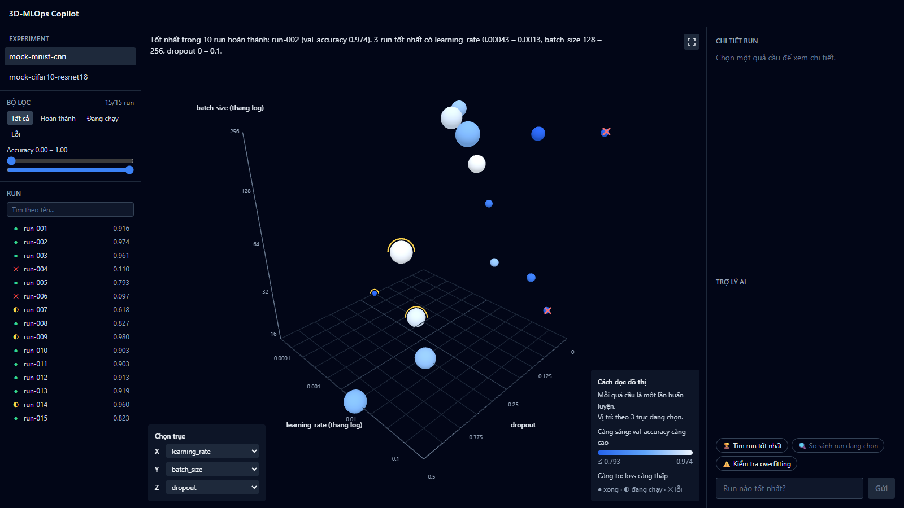
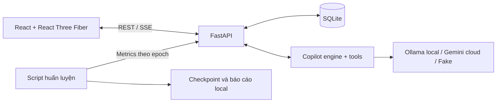

# 3D-MLOps Copilot Platform

**Theo dõi thực nghiệm học máy, khám phá kết quả trong không gian 3D và trao đổi với trợ lý AI.**

[](https://github.com/ngthdanh05/3d-mlops-copilot-platform/actions/workflows/ci.yml)
[](https://github.com/ngthdanh05/3d-mlops-copilot-platform/actions/workflows/security-audit.yml)


3D-MLOps Copilot kết nối script huấn luyện, API tracking và dashboard trong một luồng làm việc trên máy cá nhân. Mỗi lần huấn luyện (*run*) được biểu diễn bằng một điểm 3D; bạn có thể xem siêu tham số, theo dõi đường cong học, so sánh kết quả và hỏi AI về dữ liệu đã ghi nhận.



[Bắt đầu nhanh](#bắt-đầu-nhanh) · [CIFAR-10 và AI local](docs/CIFAR10-LOCAL-RUNBOOK.md) · [Luồng dữ liệu](docs/DATA-FLOW-AND-TEST-WALKTHROUGH.md) · [Đóng góp](CONTRIBUTING.md)

## Mục lục

- [Tính năng](#tính-năng)
- [Bắt đầu nhanh](#bắt-đầu-nhanh)
- [Sử dụng](#sử-dụng)
- [Cấu hình](#cấu-hình)
- [Kiến trúc](#kiến-trúc)
- [Tài liệu API](#tài-liệu-api)
- [Cấu trúc thư mục](#cấu-trúc-thư-mục)
- [Kiểm thử và CI](#kiểm-thử-và-ci)
- [Tài liệu dự án](#tài-liệu-dự-án)
- [Phạm vi và giới hạn](#phạm-vi-và-giới-hạn)
- [Đóng góp](#đóng-góp)

## Tính năng

| Nhóm | Khả năng hiện có |
|---|---|
| **Experiment tracking** | Quản lý experiment, run, siêu tham số và metrics theo epoch qua REST API; lưu dữ liệu trong SQLite. |
| **Trực quan hóa 3D** | Chọn trục, xoay/zoom, lọc run, xem chi tiết và đưa camera tới run được chọn. Màu và kích thước phản ánh kết quả huấn luyện. |
| **Theo dõi huấn luyện** | Hiển thị train/validation accuracy và loss theo epoch; polling mỗi 4 giây khi có run đang chạy và tab đang hiển thị. |
| **AI Copilot** | Tìm run tốt nhất, so sánh run, phân tích dấu hiệu overfitting bằng công cụ truy vấn; làm nổi bật run và mở bảng chi tiết ngay trong giao diện. |
| **AI local hoặc cloud** | Ollama cho model local, Gemini khi chủ động bật cloud, provider giả lập cho demo/test. Có tùy chọn tắt lưu lịch sử chat trên trình duyệt. |
| **CIFAR-10** | Huấn luyện Small CNN/ResNet-18 bằng PyTorch, split tái lập, checkpoint/resume, evaluation, prediction và metadata checkpoint trong dashboard. |
| **Kiểm tra tự động** | Lint, typecheck, unit test, build, regression training trên CPU và audit dependency bằng GitHub Actions. |

## Bắt đầu nhanh

### Yêu cầu

- Git, **Python 3.11+** và **uv**.
- **Node.js 20.19+ hoặc 22.12+**, **pnpm 10**.
- Trình duyệt hỗ trợ WebGL 2.0.
- Ollama và PyTorch chỉ cần cho các luồng AI local hoặc huấn luyện CIFAR-10 tương ứng.

Luồng demo bên dưới dùng dữ liệu giả lập và provider `fake` mặc định, không cần GPU hoặc API key. Lần cài dependency đầu tiên cần kết nối mạng.

### 1. Clone repository

```bash
git clone https://github.com/ngthdanh05/3d-mlops-copilot-platform.git
cd 3d-mlops-copilot-platform
```

### 2. Khởi động backend

Trong terminal thứ nhất, từ thư mục gốc dự án:

```bash
cd backend
uv sync --locked
uv run python -m app.utils.seed_data
uv run uvicorn app.main:app --reload
```

Lệnh seed tạo hai experiment `mock-mnist-cnn` và `mock-cifar10-resnet18`, mỗi experiment có 15 run. Dữ liệu được lưu trong `backend/mlops.db`; chạy lại sẽ bỏ qua experiment mẫu đã tồn tại.

Bạn có thể dùng cấu hình mặc định mà không tạo `.env`. Để tùy chỉnh, sao chép [backend/.env.example](backend/.env.example) thành `backend/.env` rồi sửa theo mục [Cấu hình](#cấu-hình). Trong PowerShell, dùng `Copy-Item .env.example .env` khi đang ở `backend/`.

### 3. Khởi động frontend

Trong terminal thứ hai, từ thư mục gốc dự án:

```bash
cd frontend
pnpm install --frozen-lockfile
pnpm dev
```

| Địa chỉ | Nội dung |
|---|---|
| [localhost:5173](http://localhost:5173) | Dashboard 3D |
| [localhost:8000/docs](http://localhost:8000/docs) | Swagger UI để khám phá và thử API |
| [localhost:8000/redoc](http://localhost:8000/redoc) | Tài liệu ReDoc |
| [localhost:8000/api/health](http://localhost:8000/api/health) | Health check, trả về `{"status":"ok"}` |

Vite chuyển request `/api` tới backend ở `http://localhost:8000`. Giữ cả hai terminal đang chạy khi sử dụng dashboard.

### 4. Khám phá dashboard

1. Chọn experiment `mock-mnist-cnn` ở sidebar.
2. Xoay/zoom đồ thị và chọn một run để xem siêu tham số cùng metrics.
3. Thay đổi trục hoặc lọc run theo trạng thái, accuracy và tên.
4. Hỏi **“Run nào tốt nhất?”** để thử Copilot giả lập.

Provider `fake` chỉ hỗ trợ luồng tìm run tốt nhất và đánh dấu câu trả lời là giả lập. Để so sánh hoặc phân tích bằng AI, cấu hình Ollama hoặc Gemini ở phần dưới. Các experiment `mock-*` chứa dữ liệu giả lập, không phải kết quả huấn luyện thật.

## Sử dụng

### Bật AI local với Ollama

Chuẩn bị runtime Ollama và model theo [hướng dẫn CIFAR-10/local](docs/CIFAR10-LOCAL-RUNBOOK.md), sau đó đặt trong `backend/.env`:

```dotenv
LLM_PROVIDER=ollama
OFFLINE=true
LLM_BASE_URL=http://127.0.0.1:11434
LLM_MODEL=qwen3:4b-instruct-2507-q4_K_M
LLM_TIMEOUT=120
LLM_CONTEXT=12288
```

Khởi chạy Ollama với model đã tải và khởi động lại backend để nhận cấu hình mới. Endpoint `/api/copilot/status` cho biết provider, model và trạng thái sẵn sàng.

Ví dụ câu hỏi:

- “Run nào có val_accuracy cao nhất?”
- “So sánh run-001 với run-002.”
- “run-002 có dấu hiệu overfitting không?”

Copilot lấy số liệu qua các công cụ backend và trả về hành động điều khiển giao diện. Việc phân tích overfitting được tính từ metrics train/validation; AI không trực tiếp ghi vào database.

### Huấn luyện CIFAR-10

Backend phải đang chạy để nhận tracking. Các lệnh sau thực hiện từ `backend/`; bước chuẩn bị sẽ tải dependency và dataset:

```bash
uv sync --locked --group training
uv run --locked --group training python scripts/prepare_cifar10.py
uv run --locked --group training python scripts/train_cifar10.py --device cuda --epochs 4
```

Dùng `--device cpu` nếu muốn chạy trên CPU. Pipeline hỗ trợ `small-cnn` và `resnet18`; checkpoint cùng báo cáo nằm trong `backend/artifacts/cifar10/<local-id>/`. Dataset và model không được lưu trong Git.

`best.pt` được chọn theo validation accuracy, còn `last.pt` dùng để khôi phục huấn luyện. Metrics `final_*` trong API thuộc epoch cuối đã ghi, có thể khác metrics của checkpoint tốt nhất.

Xem [runbook](docs/CIFAR10-LOCAL-RUNBOOK.md) để thực hiện resume, sweep, đánh giá test, dự đoán ảnh và vận hành offline sau khi chuẩn bị tài nguyên.

### Ghi log từ script của bạn

Client có sẵn tại [backend/scripts/log_to_api.py](backend/scripts/log_to_api.py). Ví dụ trong một script Python chạy từ `backend/`, khi API đã khởi động:

```python
from scripts.log_to_api import TrackingClient

with TrackingClient("http://localhost:8000") as client:
    experiment = client.ensure_experiment("my-experiment")
    params = {"learning_rate": 0.001, "batch_size": 32, "epochs": 1}

    with client.start_run(experiment["id"], params) as run:
        # Thay các giá trị minh họa bằng metrics từ vòng lặp huấn luyện.
        run.log(1, accuracy=0.91, loss=0.31, val_accuracy=0.88, val_loss=0.36)
```

Run chuyển sang `completed` khi thoát khối `with` thành công, hoặc `failed` nếu có exception. Dùng các key siêu tham số thống nhất như `learning_rate`, `batch_size`, `epochs` để thuận tiện chọn trục 3D.

Muốn thử huấn luyện nhẹ bằng scikit-learn với tập chữ số có sẵn, chạy `uv run python scripts/train_mnist_demo.py --sweep` trong `backend/`.

## Cấu hình

Backend đọc biến môi trường và file `backend/.env`. Danh sách đầy đủ nằm trong [file mẫu](backend/.env.example) và [app/config.py](backend/app/config.py).

| Biến | Mặc định trong code | Ý nghĩa |
|---|---|---|
| `DATABASE_URL` | SQLite tại `backend/mlops.db` | Chuỗi kết nối database async. |
| `DEBUG` | `false` | Bật log câu lệnh SQL. |
| `CORS_ORIGINS` | localhost/127.0.0.1 trên cổng 5173 và 3000 | Danh sách origin frontend, khai báo dưới dạng JSON array. |
| `LLM_PROVIDER` | `fake` | Chọn `fake`, `ollama` hoặc `gemini`. |
| `OFFLINE` | `true` | Chặn sử dụng provider Gemini. |
| `LLM_BASE_URL` | `http://127.0.0.1:11434` | Địa chỉ Ollama; chỉ chấp nhận HTTP loopback. |
| `LLM_MODEL` | Không đặt | Ollama cần model đã tải; file `.env.example` điền sẵn model Qwen dùng cho local. |
| `LLM_API_KEY` | Không đặt | API key khi chọn Gemini. |
| `LLM_TIMEOUT` / `LLM_CONTEXT` | `120` / `12288` | Timeout request (giây) và ngân sách context local. |

Gemini chỉ được bật khi đặt `LLM_PROVIDER=gemini`, `OFFLINE=false` và cung cấp `LLM_API_KEY`. Chọn `LLM_MODEL` phù hợp với provider; ứng dụng không tự chuyển provider khi xảy ra lỗi. API key luôn nằm ở backend; không commit `.env` vào Git.

`OFFLINE=true` kiểm soát lựa chọn provider, không thay thế firewall. Hướng dẫn chặn kết nối ngoài loopback cho tiến trình Python và chuẩn bị tài nguyên offline nằm trong [runbook](docs/CIFAR10-LOCAL-RUNBOOK.md).

## Kiến trúc



- **Frontend:** React 18, TypeScript, Vite, Tailwind CSS, React Three Fiber/drei và Zustand. Đồ thị 3D, Inspector và chat dùng chung trạng thái lựa chọn run.
- **Backend:** FastAPI, Pydantic, SQLAlchemy async và aiosqlite. Các router gọi service layer để quản lý experiment, run và metrics.
- **Copilot:** adapter provider, vòng lặp tool calling và các công cụ truy vấn/điều khiển UI. Lời gọi LLM đi qua backend.
- **Training:** PyTorch/Torchvision cho CIFAR-10; scikit-learn cho demo chữ số. Checkpoint lưu trên filesystem, metadata được liên kết với run.

Mô hình dữ liệu chính: `Experiment → Run → Metric`. Xem [sơ đồ luồng dữ liệu và bài thực hành](docs/DATA-FLOW-AND-TEST-WALKTHROUGH.md) để theo dõi từ script huấn luyện đến database, API, UI và Copilot.

## Tài liệu API

Tài liệu tương tác đầy đủ có tại [Swagger UI](http://localhost:8000/docs) khi backend đang chạy.

| Nhóm | Endpoint chính | Chức năng |
|---|---|---|
| Health | `GET /api/health` | Kiểm tra backend. |
| Experiments | `/api/experiments`, `/api/experiments/{id}` | Tạo, liệt kê, xem và xóa experiment. |
| Runs | `/api/runs`, `/api/runs/{id}` | Tạo, liệt kê, xem, cập nhật trạng thái và xóa run. |
| Metrics | `POST /api/runs/{id}/metrics` | Ghi metrics cho một epoch. |
| Copilot | `GET /api/copilot/status` | Kiểm tra provider và model local. |
| Chat | `POST /api/copilot/chat` | Nhận câu trả lời và các UI action. |
| Streaming | `POST /api/copilot/chat/stream` | Nhận câu trả lời qua Server-Sent Events. |

`GET /api/runs?experiment_id=<id>` lọc theo experiment; chi tiết run chứa timeline metrics. API kiểm tra dữ liệu đầu vào và trả về `404` khi không tìm thấy, `409` khi xung đột, `422` khi dữ liệu không hợp lệ.

## Cấu trúc thư mục

```text
3d-mlops-copilot-platform/
├── .github/workflows/     # CI và audit dependency
├── backend/
│   ├── app/               # API, schemas, models, tracking và Copilot
│   ├── scripts/           # Training, tracking client, CLI và smoke test
│   ├── training/          # Dataset, models, checkpoint và training engine
│   ├── tests/             # Pytest và regression tests
│   ├── .env.example       # Cấu hình mẫu
│   ├── pyproject.toml
│   └── uv.lock
├── frontend/
│   ├── src/               # Components, hooks, stores và API client
│   ├── scripts/           # Browser smoke test và benchmark
│   └── package.json
├── docs/                  # Runbook, demo, thiết kế và báo cáo
├── CONTRIBUTING.md
└── README.md
```

## Kiểm thử và CI

Backend, từ `backend/`:

```bash
uv run ruff format --check .
uv run ruff check .
uv run pytest --cov
```

Các test training cần dependency tùy chọn; dùng `uv run --group training pytest tests/test_cifar_training.py tests/test_cifar_recovery.py` để chạy regression với fixture tổng hợp, không tải dataset hay trọng số pretrained.

Frontend, từ `frontend/`:

```bash
pnpm lint
pnpm typecheck
pnpm test:coverage
pnpm build
```

Smoke test, sau khi đã cài dependency cho cả hai phần, từ `backend/`:

```bash
uv run python scripts/smoke_test.py
```

Smoke test mở backend/frontend trên cổng riêng và dùng database tạm. Cần Chrome hoặc Edge cho phần trình duyệt; thêm `--no-browser` để chỉ kiểm tra API/server.

| Workflow | Nội dung | Khi chạy |
|---|---|---|
| [CI](.github/workflows/ci.yml) | Backend lint/test/coverage, training regression trên CPU; frontend lint/typecheck/test/build. | PR vào `main`, push lên `main`, chạy thủ công. |
| [Security audit](.github/workflows/security-audit.yml) | `pip-audit` cho dependency Python đã khóa, gồm nhóm training/dev; `pnpm audit` cho frontend. | PR vào `main`, push `main`, thứ Hai 09:00 giờ Bangkok, chạy thủ công. |

Python audit thất bại khi có lỗ hổng đã biết hoặc package không audit được; frontend audit thất bại ở mức high/critical. Audit báo cáo vấn đề và không tự sửa dependency.

## Tài liệu dự án

| Tài liệu | Nội dung |
|---|---|
| [CIFAR-10 và Copilot local](docs/CIFAR10-LOCAL-RUNBOOK.md) | Chuẩn bị máy, model, dataset; train/resume, evaluate/predict và chạy offline trên Windows. |
| [Luồng dữ liệu và thực hành](docs/DATA-FLOW-AND-TEST-WALKTHROUGH.md) | Đọc code theo từng chặng và kiểm chứng API, database, giao diện, AI. |
| [Báo cáo triển khai CIFAR-10](docs/CIFAR10-IMPLEMENTATION-REPORT.md) | Kết quả training, benchmark và phạm vi kiểm chứng tại thời điểm đo. |
| [Kịch bản demo](docs/DEMO.md) | Các bước trình diễn dashboard và Copilot. |
| [Hiệu năng](docs/performance.md) | Số đo và điều kiện benchmark. |
| [Kế hoạch dự án](docs/PLAN.md) | Thiết kế và lộ trình ban đầu. |
| [Kế hoạch CIFAR-10/local AI](docs/PLAN-CIFAR10-LOCAL-AI.md) | Các hạng mục triển khai pipeline huấn luyện và AI local. |

## Phạm vi và giới hạn

- Đây là bản **Proof of Concept** cho một người dùng trên localhost; chưa có đăng nhập, phân quyền hay triển khai nhiều người dùng.
- Metrics tracking hiện gồm `accuracy`, `loss`, `val_accuracy`, `val_loss`, tập trung vào bài toán phân loại.
- Checkpoint và dataset được lưu cục bộ; chưa có kho artifact tập trung hay API tải model.
- Dashboard chọn một experiment tại một thời điểm; chưa có chế độ so sánh nhiều experiment hoặc giảm chiều PCA.
- Vận hành local cần tải sẵn dependency, dataset và model. Tài nguyên RAM/VRAM phụ thuộc cấu hình training và LLM; xem runbook trước khi chạy đồng thời.
- Kết quả accuracy và hiệu năng trong các báo cáo gắn với phiên bản, thiết bị và dữ liệu tại thời điểm đo.

## Đóng góp

Xem [CONTRIBUTING.md](CONTRIBUTING.md) để thiết lập môi trường, đặt tên branch/commit và chạy kiểm tra trước khi mở pull request. Báo lỗi hoặc đề xuất cải tiến tại [GitHub Issues](https://github.com/ngthdanh05/3d-mlops-copilot-platform/issues).
