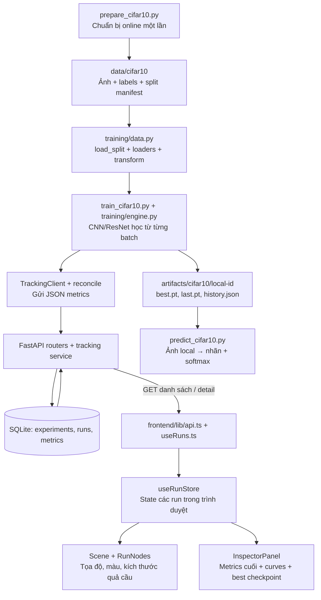
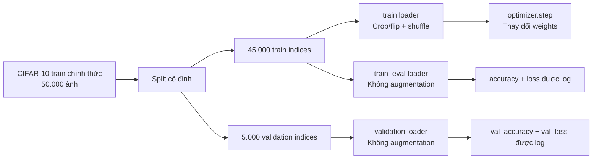
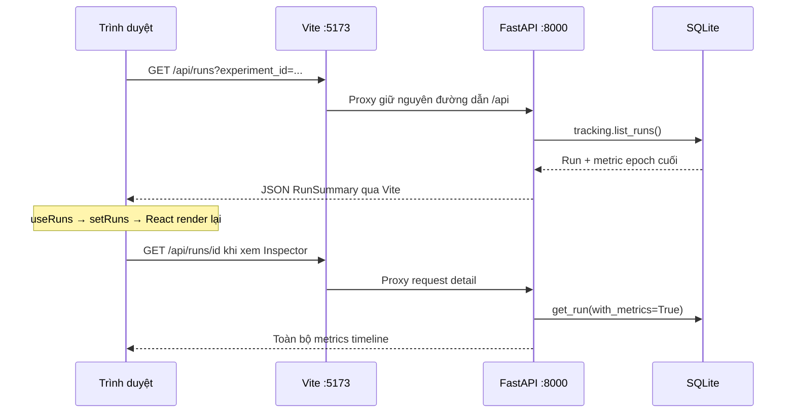
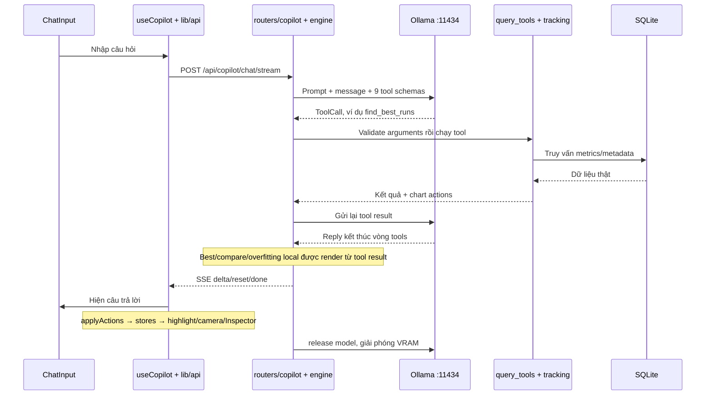
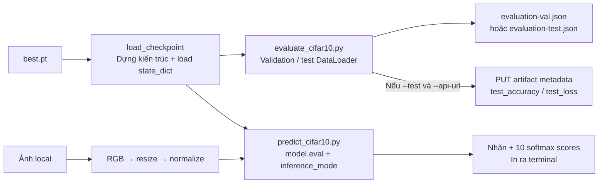

# Đi theo một run: dữ liệu → backend → frontend → copilot

Đối chiếu mã nguồn ngày **19/11/2026**. Tài liệu này dùng để vừa đọc code, vừa chạy thử,
vừa quan sát request và giao diện. Các lệnh dùng PowerShell trên Windows.

## 1. Nhìn toàn bộ trước khi đọc từng file

Có hai mô hình độc lập: **CNN/ResNet phân loại ảnh**, còn **LLM hiểu câu hỏi và chọn tools**.
Một quả cầu trên giao diện đại diện cho **một run huấn luyện**, không đại diện cho một ảnh.



**Ảnh/tensor và trọng số không được gửi lên frontend.** Backend tracking nhận các số đo JSON.
SQLite lưu metadata; checkpoint và ảnh nằm trên filesystem. Prediction ảnh hiện là CLI riêng,
chưa có luồng upload ảnh/phân loại ảnh trên web.

## 2. Bám theo file đang mở: `backend/training/data.py`

| Hàm | Nhận vào → trả ra | Lý do có bước này |
| --- | --- | --- |
| `resolve()` | Đường dẫn tương đối → đường dẫn dựa trên backend | Chạy script từ thư mục khác vẫn tìm đúng dataset/artifact |
| `split_manifest()` | Labels + seed + ảnh train → indices, mean/std, split ID | Giữ split cố định; thống kê normalization chỉ lấy từ 45.000 ảnh train |
| `transform()` | Ảnh PIL → tensor `[3,32,32]` đã normalize | `augment=True` mới thêm crop/flip ngẫu nhiên |
| `local_dataset()` | Root + train/test + preprocessing → CIFAR10 | Luôn `download=False`; dữ liệu thiếu/hỏng sẽ yêu cầu chạy prepare |
| `load_split()` | Root + seed → manifest đã xác minh | So manifest đã lưu với split/thống kê dựng lại từ dữ liệu local |
| `seed_worker()` | Seed worker → seed Python/NumPy | Phục vụ tái lập khi bật DataLoader workers |
| `loaders()` | Dataset + manifest + batch size → 3 DataLoader | Tách train tối ưu, train đánh giá và validation |

Ba loader có vai trò khác nhau:



Với batch size 32, mỗi lượt thường đưa vào model tensor `[32,3,32,32]`, nhận logits `[32,10]`.
Batch cuối có thể nhỏ hơn 32; `drop_last=False` giữ lại mẫu đó. Accuracy là số dự đoán đúng /
tổng số mẫu; loss được cộng theo số mẫu từng batch rồi chia tổng, không lấy trung bình batch ngang nhau.

`--subset 128` cắt **cả train lẫn validation loader còn 128 mẫu**. Nó không tạo split chuẩn mới.
Split ID vẫn mô tả split đầy đủ, và metadata `subset` ghi ngân sách smoke đang dùng.

## 3. Một epoch đi qua backend như thế nào?

| Thứ tự | File và hàm | Điều cần quan sát |
| --- | --- | --- |
| 1 | [train_cifar10.py](../backend/scripts/train_cifar10.py) → `main()` | Parse CLI, chọn device, seed, load manifest/loaders |
| 2 | [models.py](../backend/training/models.py) → `build_model()` | Dựng small-cnn hoặc ResNet-18, không tải pretrained weights |
| 3 | [engine.py](../backend/training/engine.py) → `epoch(..., optimizer)` | `model.train()`, cross-entropy, backward, Adam step |
| 4 | Cùng `epoch()`, không truyền optimizer | `model.eval()`, tắt gradient; đo lại train và validation |
| 5 | `save_checkpoint()` + `atomic_json()` | Lưu best/last và history **trước khi** ghi metrics lên API |
| 6 | [training/tracking.py](../backend/training/tracking.py) → `reconcile()` | GET metrics đã log; kiểm tra khớp, chỉ POST epoch còn thiếu |
| 7 | [log_to_api.py](../backend/scripts/log_to_api.py) → `TrackingClient.log_metric()` | Gửi bốn số đo dưới dạng JSON |
| 8 | [routers/metrics.py](../backend/app/routers/metrics.py) → `log_metric()` | Nhận HTTP, validate `MetricCreate` |
| 9 | [services/tracking.py](../backend/app/services/tracking.py) → `log_metric()` | Tạo ORM Metric, commit qua SQLAlchemy |
| 10 | [database.py](../backend/app/database.py) + [models/metric.py](../backend/app/models/metric.py) | SQLite lưu dòng metric có `run_id` và `epoch` |

Experiment và run được tạo bằng `ensure_experiment()` / `create_run()` trước vòng epoch.
Run bắt đầu `running`; sau khi log đủ sẽ `completed`. Lỗi trong vòng train khiến trainer ghi
`status.json` cục bộ và thử đánh dấu `failed` qua API.

Ví dụ payload dưới đây **chỉ minh họa cấu trúc**, không phải kết quả chạy mới:

```json
{
  "epoch": 1,
  "accuracy": 0.52,
  "loss": 1.31,
  "val_accuracy": 0.51,
  "val_loss": 1.34
}
```

Request này đi tới `POST /api/runs/{run_id}/metrics`. Artifact metadata và trạng thái đi qua
`PUT /api/runs/{run_id}`. Ảnh và weights không nằm trong các request này.

Nếu server đã nhận metric nhưng response bị mất, `last.pt` vẫn còn. Khi resume, `reconcile()`
so số liệu đã có rồi bỏ qua epoch khớp; dữ liệu xung đột sẽ báo lỗi. Đây là lý do không retry POST mù.

## 4. Từ SQLite tới quả cầu và biểu đồ



| File/hàm frontend | Vai trò |
| --- | --- |
| [vite.config.ts](../frontend/vite.config.ts) → `server.proxy` | Chuyển `/api` từ cổng 5173 tới backend; `API_PROXY_TARGET` ghi đè đích mặc định |
| [lib/api.ts](../frontend/src/lib/api.ts) → `fetchExperiments`, `fetchRuns`, `fetchRunDetail` | Gọi HTTP và đọc JSON |
| [useRuns.ts](../frontend/src/hooks/useRuns.ts) → `useRuns()` | SWR lấy dữ liệu, polling khoảng 4 giây khi có run running, dừng polling ở tab ẩn |
| [useRunStore.ts](../frontend/src/store/useRunStore.ts) → `setRuns()` | Giữ danh sách run và lựa chọn hiện tại trong RAM của browser |
| [Scene.tsx](../frontend/src/components/three/Scene.tsx) → `Scene()` | Đọc store, gọi `layoutRuns()` và `encodeRuns()` |
| [coordinate-mapper.ts](../frontend/src/utils/coordinate-mapper.ts) → `layoutRuns()` | Chuyển hyperparameters hoặc metric được chọn thành tọa độ 3D |
| [color-utils.ts](../frontend/src/utils/color-utils.ts) → `encodeRuns()` | Màu ưu tiên final validation accuracy; radius ưu tiên final validation loss |
| [RunNodes.tsx](../frontend/src/components/three/RunNodes.tsx), [RunNode.tsx](../frontend/src/components/three/RunNode.tsx) | Vẽ mỗi run; trên 100 run dùng instancing |
| [InspectorPanel.tsx](../frontend/src/components/panels/InspectorPanel.tsx) → `LearningCurves()` | Fetch detail riêng để vẽ từng điểm epoch và hiện best checkpoint |

Accuracy cao hơn làm màu sáng hơn; loss thấp hơn làm quả cầu lớn hơn trong miền màu/kích thước
đang dùng. Màu là so sánh tương đối giữa các run, không phải giá trị accuracy tuyệt đối cố định.
Các trục do người dùng chọn; tọa độ không phải embedding ảnh.

Danh sách run dùng `RunSummary.from_run()` trong [schemas/run.py](../backend/app/schemas/run.py),
chỉ có `final_*` của epoch cuối. Detail trả toàn timeline để Inspector vẽ curves.
Polling metrics là HTTP GET định kỳ; nó không dùng WebSocket. **Chat** mới dùng SSE.
Khi chưa có run running, bấm **Làm mới dữ liệu** để phát hiện run mới.

## 5. Hỏi copilot và điều khiển giao diện



Các điểm đọc code theo thứ tự:

1. [ChatInput.tsx](../frontend/src/components/copilot/ChatInput.tsx): nhận câu hỏi.
2. [useCopilot.ts](../frontend/src/hooks/useCopilot.ts): `sendCopilotMessage()` thêm message vào chat store,
   gọi `streamCopilotChat()`; event `done` quyết định nội dung cuối và `applyActions()`.
3. [routers/copilot.py](../backend/app/routers/copilot.py): `chat_stream()` trả `StreamingResponse`;
   `_server_sent_events()` đóng gói event thành dòng `data: ...`.
4. [engine.py](../backend/app/services/copilot/engine.py): `answer_events()` điều phối tối đa 8 vòng;
   `_run_tool()` chỉ chạy tools có trong danh sách và validate arguments bằng schema.
5. [llm_client.py](../backend/app/services/copilot/llm_client.py): `get_llm_client()` chọn provider;
   [ollama_client.py](../backend/app/services/copilot/ollama_client.py) ánh xạ messages/tool results sang API Ollama.
6. [query_tools.py](../backend/app/services/copilot/query_tools.py): truy vấn qua service tracking,
   không để LLM tự đọc SQLite. Sáu query tools: list experiments, tìm tên run, lấy run, tìm best,
   so sánh và phát hiện dấu hiệu overfitting.
7. [tool_base.py](../backend/app/services/copilot/tool_base.py): `ToolContext.show_runs()` tự tạo
   `highlight_runs`, `focus_camera`, `open_inspector` cho ba query chính. Có thêm ba UI tools tường minh
   trong [ui_tools.py](../backend/app/services/copilot/ui_tools.py).
8. [grounded.py](../backend/app/services/copilot/grounded.py): `render_grounded()` dựng nội dung best,
   compare, overfitting từ kết quả tool cho chế độ local, tránh đảo winner hoặc thêm số sai.
9. `applyActions()` cập nhật [useCameraStore.ts](../frontend/src/store/useCameraStore.ts), run store;
   [CameraController.tsx](../frontend/src/components/three/CameraController.tsx) thực hiện camera bay tới node.

Browser chỉ POST `message` và `experiment_id`; lịch sử hiển thị trong chat store/localStorage
không được tự động gửi hết lên LLM ở mỗi câu hỏi. Tool result là dữ liệu được gửi từ backend tới
LLM local. Ollama không phải CNN đang phân loại ảnh và không tự mở file checkpoint.

Tên run trùng experiment được chặn để yêu cầu chọn experiment. Overfitting là heuristic;
giá trị trung bình cửa sổ cuối được ghi rõ, không gọi nhầm là metric epoch cuối.

## 6. Evaluation và prediction đi đâu?



Checkpoint giữ cả preprocessing và tên lớp. Prediction lấy lại các thông tin đó để không normalize
khác lúc evaluation. Softmax chưa phải xác suất tin cậy đã hiệu chuẩn.
Evaluation mặc định dùng **đủ 5.000 validation ảnh**, kể cả checkpoint được train bằng subset.
Vì vậy, evaluation của smoke run có thể khác val_accuracy đã log trên 128 ảnh; đó là hai tập đánh giá
khác kích thước. Với full-data run, validation/best checkpoint phải đối chiếu trên cùng 5.000 ảnh.

## 7. Bài thực hành từ đầu đến cuối

### 7.1. Chuẩn bị: bốn terminal, một thư mục gốc

Trong mỗi PowerShell, đặt đường dẫn repo của bạn:

```powershell
$Repo = 'D:\admin\3d-mlops-copilot-platform'
```

| Terminal | Thư mục | Công việc |
| --- | --- | --- |
| A | backend | API ở 127.0.0.1:8000 |
| B | frontend | Vite ở 127.0.0.1:5173 |
| C | backend | Train, kiểm tra API, resume, evaluation/predict, tests |
| D | backend | Ollama ở 127.0.0.1:11434, chỉ cần khi test chat |

Nếu các cổng đã có server đúng project đang chạy, dùng server đó; không mở thêm server trùng cổng.
Các bước thực hành sẽ thêm run/metrics vào database hiện tại. Không xóa dữ liệu cũ.

Nếu đã có `.venv`, `node_modules`, dataset và Ollama/model cache từ lần triển khai trước,
bắt đầu ở **7.2**. Nếu chưa có, chuẩn bị online ở terminal C:

```powershell
Set-Location "$Repo\backend"
uv sync --locked --group training
uv run --locked --group training python scripts/check_training_env.py --device cuda
uv run --locked --group training python scripts/prepare_cifar10.py --parallel-download
uv run --locked --group training python scripts/prepare_ollama.py
```

Frontend cần cài dependencies online một lần bằng `pnpm install --frozen-lockfile` trong frontend.
Để có chat, chạy runtime ở **7.7**, rồi khi còn online thực hiện
`.cache/ollama/ollama.exe pull qwen3:4b-instruct-2507-q4_K_M` tại backend ở terminal khác.
Model đã có cache thì không pull lại. Chi tiết: [runbook](CIFAR10-LOCAL-RUNBOOK.md).

### 7.2. Bật API và kiểm tra đường kết nối

Terminal A:

```powershell
Set-Location "$Repo\backend"
$env:DEBUG='false'
$env:OFFLINE='true'
$env:LLM_PROVIDER='ollama'
$env:LLM_MODEL='qwen3:4b-instruct-2507-q4_K_M'
$env:LLM_BASE_URL='http://127.0.0.1:11434'
$env:LLM_CONTEXT='12288'
.venv/Scripts/python.exe scripts/run_offline.py scripts/serve_local.py
```

API có thể nhận metrics dù Ollama chưa bật. Trạng thái AI lúc đó chưa sẵn sàng là bình thường.
Đây là tiến trình giữ terminal; dùng C để gõ lệnh tiếp. Tại C:

```powershell
Set-Location "$Repo\backend"
$env:DEBUG='false'
$api = 'http://127.0.0.1:8000'
Invoke-RestMethod "$api/api/health"
```

Kỳ vọng `status=ok`. Mở `http://127.0.0.1:8000/docs` để xem endpoint/schema thực tế.

### 7.3. Bật frontend và quan sát HTTP

Terminal B, dùng trực tiếp các dependency đã cài:

```powershell
Set-Location "$Repo\frontend"
$env:API_PROXY_TARGET='http://127.0.0.1:8000'
node node_modules/vite/bin/vite.js --host 127.0.0.1
```

Mở `http://127.0.0.1:5173`, rồi F12 → **Network** → lọc `api`.
Bạn sẽ thấy `GET /api/experiments`, `GET /api/runs?experiment_id=...`,
và `GET /api/copilot/status`. Chọn một run để thấy request detail `/api/runs/{id}`.
URL trên browser đi qua cổng 5173; proxy đưa request tới backend cổng 8000.

### 7.4. Train nhanh một run thật để theo dấu

Terminal C:

```powershell
.venv/Scripts/python.exe scripts/run_offline.py scripts/train_cifar10.py --device cuda --epochs 2 --batch-size 32 --seed 42 --subset 128
```

Nếu không có CUDA, thay `--device cuda` bằng `--device cpu` cho các lệnh training/resume cùng run.
CLI không tự đổi sang CPU. Smoke dùng dữ liệu CIFAR thật nhưng quá nhỏ để đánh giá chất lượng model.

Quan sát ba nơi:

- **C:** mỗi epoch in JSON có bốn metrics; cuối lệnh in `Artifacts: ...; run_id=...`.
- **A:** GET/POST/PUT cho experiment/run/metrics. Request từ trainer không xuất hiện trong Network
  của browser, vì đó là HTTP do Python gửi.
- **Browser:** bấm **Làm mới dữ liệu**, chọn `real-cifar10-smoke`, chọn run vừa tạo để thấy curves.

Smoke có thể xong trước khi bạn nhìn thấy `running`. Để quan sát lâu hơn, có thể chạy full-data:

```powershell
.venv/Scripts/python.exe scripts/run_offline.py scripts/train_cifar10.py --device cuda --epochs 2 --batch-size 32 --seed 42
```

Run full-data vào `real-cifar10`. Khi có run running trong experiment đang xem, GET list lặp khoảng
4 giây/lần và metrics mới cập nhật lên node. Một epoch thêm **một điểm** trên curves của cùng run,
không tạo thêm một quả cầu.

### 7.5. Đọc cùng một dữ liệu ở API và filesystem

Vẫn C, lấy smoke run mới nhất. Nếu nhiều trainer cùng chạy, dùng chính `run_id` CLI vừa in ra.

```powershell
$experiments = Invoke-RestMethod "$api/api/experiments"
$smokeExp = $experiments | Where-Object { $_.name -eq 'real-cifar10-smoke' }
$runs = Invoke-RestMethod "$api/api/runs?experiment_id=$($smokeExp.id)"
$run = $runs | Sort-Object id -Descending | Select-Object -First 1
$runId = $run.id
$detail = Invoke-RestMethod "$api/api/runs/$runId"
$detail.metrics | Format-Table epoch,accuracy,loss,val_accuracy,val_loss
$detail.artifacts | ConvertTo-Json
```

Lấy thư mục artifact bằng `manifest.run_id`, vì tên thư mục là local UUID chứ không phải run ID SQL:

```powershell
$artifactDir = Get-ChildItem -LiteralPath .\artifacts\cifar10 -Directory | Where-Object {
    $manifestPath = Join-Path $_.FullName 'manifest.json'
    (Test-Path -LiteralPath $manifestPath) -and
        ((Get-Content -Raw -Encoding UTF8 -LiteralPath $manifestPath | ConvertFrom-Json).run_id -eq $runId)
} | Select-Object -First 1
if (-not $artifactDir) { throw 'Không tìm thấy manifest cho run đã chọn' }
$last = Join-Path $artifactDir.FullName 'last.pt'
$best = Join-Path $artifactDir.FullName 'best.pt'
Get-ChildItem -LiteralPath $artifactDir.FullName
$history = Get-Content -Raw -Encoding UTF8 -LiteralPath (Join-Path $artifactDir.FullName 'history.json') | ConvertFrom-Json
$history | Format-Table epoch,accuracy,loss,val_accuracy,val_loss
```

Các số trong hai bảng phải khớp. `last.pt` ở epoch cuối; `best.pt` ở epoch có val_accuracy cao nhất,
hòa giữ epoch sớm nhất. Không chỉnh JSON để làm đẹp số liệu.

### 7.6. Resume và nạp lại model

Tiếp tục **smoke run** từ 2 lên tổng cộng 4 epoch, giữ cấu hình/subset giống ban đầu:

```powershell
.venv/Scripts/python.exe scripts/run_offline.py scripts/train_cifar10.py --resume $last --device cuda --epochs 4 --batch-size 32 --seed 42 --subset 128
$detail = Invoke-RestMethod "$api/api/runs/$runId"
$detail.metrics | Format-Table epoch,accuracy,loss,val_accuracy,val_loss
$detail.hyperparams.epochs
```

Kỳ vọng epochs `1,2,3,4`, cùng run ID, không log lại `1,2`; target epochs là `4`.
Nếu đã chọn CPU ở 7.4 thì dùng CPU ở đây. Nếu đang resume full-data, bỏ `--subset 128`.

Tạo ảnh minh họa từ CIFAR local, rồi chạy prediction ở tiến trình mới:

```powershell
.venv/Scripts/python.exe -c "from torchvision.datasets import CIFAR10; from training.data import resolve; d=CIFAR10(str(resolve('data/cifar10')),train=True,download=False); image,label=d[0]; image.save(resolve('artifacts/walkthrough-image.png')); print('ground_truth:',d.classes[label])"
.venv/Scripts/python.exe scripts/run_offline.py scripts/predict_cifar10.py $best artifacts/walkthrough-image.png
.venv/Scripts/python.exe scripts/run_offline.py scripts/evaluate_cifar10.py $best --device cuda
```

Prediction phải trả label và 10 scores; **không bắt buộc label đúng** với smoke model.
Evaluation đọc đủ 5.000 validation ảnh nên không so trực tiếp với val metric trên 128 ảnh smoke.
Sau khi chốt cấu hình bằng validation của full-data run, mới chạy đánh giá test cuối:

```powershell
# $selectedBest phải trỏ best.pt của full-data run đã chốt, không mặc định là $best của smoke.
# Ví dụ đang có trong workspace sau lượt triển khai 18/11/2026:
$selectedBest = 'artifacts/cifar10/9979d2c952de4169896f89625e3bc3d0/best.pt'
.venv/Scripts/python.exe scripts/run_offline.py scripts/evaluate_cifar10.py $selectedBest --device cuda --test --api-url $api
```

Đường dẫn ví dụ chỉ dùng nếu artifact còn trên máy. Run được chọn trước đó có best epoch 3,
val_accuracy 0.7574; final epoch 4 có val_accuracy 0.7488; test accuracy 0.7489.
Đây là kết quả đã đo ngày 18/11, không phải mức accuracy bảo đảm cho run vừa tạo.

### 7.7. Chat local, xem tool result biến thành UI actions

Chạy xong training/evaluation rồi mới test chat để dùng GPU luân phiên. Terminal D:

```powershell
Set-Location "$Repo\backend"
$env:OLLAMA_HOST='127.0.0.1:11434'
$env:OLLAMA_NO_CLOUD='1'
$env:OLLAMA_MODELS=Join-Path (Get-Location) '.cache/ollama/models'
$env:OLLAMA_CONTEXT_LENGTH='12288'
$env:OLLAMA_MAX_LOADED_MODELS='1'
$env:OLLAMA_NUM_PARALLEL='1'
.cache/ollama/ollama.exe serve
```

Nếu runtime/model chưa được tải thì quay lại phần chuẩn bị online. Terminal C kiểm tra:

```powershell
Invoke-RestMethod "$api/api/copilot/status"
```

Kỳ vọng `provider=ollama`, đúng model, `available=true`, `offline=true`.
`available=true` nghĩa là model đã cache và runtime trả được tags, chưa phải chứng nhận câu trả lời đúng.

Trên UI chọn `real-cifar10` nếu đã có các run đầy đủ, rồi hỏi:

1. `Run nào tốt nhất theo val_accuracy?`
2. `So sánh <tên-run-A> và <tên-run-B>` — dùng tên thật của hai run trong experiment.
3. `<tên-run-A> có dấu hiệu overfitting không?`

Trong Network mở POST `/api/copilot/chat/stream`: body có message/experiment_id, response là
`text/event-stream`. Nếu DevTools hỗ trợ sẽ thấy EventStream; nếu không xem tab Response.
Event `done` chứa `message` và `actions`. Kiểm tra node highlight, camera và Inspector cùng trỏ run
được trả về. Cold load đã đo khoảng một phút; local buffering khiến chữ đầu xuất hiện khá muộn.
Không coi HTTP 200 là đủ: phải xem nội dung event `done` có phải thông báo lỗi hay không.

Best run đang được xếp theo metric **epoch cuối** của completed runs. Nó không tự xếp lại theo
best checkpoint. Inspector hiển thị best checkpoint riêng để bạn phân biệt hai giá trị.
Nếu chỉ có một smoke run thì compare chưa đủ dữ liệu; tạo run thứ hai với cùng lệnh smoke 4 epoch
hoặc dùng experiment đã có ít nhất hai completed runs. Overfitting cần ít nhất 4 epoch validation
để có xu hướng; thiếu dữ liệu phải được báo rõ.

### 7.8. Chạy tests tự động sau khi đã hiểu luồng

Terminal C — tests fixtures trên CPU, không cần backend/runtime đang bật và không tải dataset/model:

```powershell
$pytestDir = '.cache/pytest-walkthrough-' + (Get-Date -Format 'yyyyMMdd-HHmmss')
.venv/Scripts/python.exe -m pytest tests/test_cifar_training.py tests/test_cifar_tracking.py tests/test_cifar_recovery.py tests/test_ollama_client.py tests/test_grounded_local.py -q -p no:cacheprovider --basetemp=$pytestDir
```

Chạy regression đầy đủ, vẫn từ backend:

```powershell
$pytestDir = '.cache/pytest-all-' + (Get-Date -Format 'yyyyMMdd-HHmmss')
.venv/Scripts/python.exe -m pytest -q -p no:cacheprovider --basetemp=$pytestDir
.venv/Scripts/ruff.exe check app scripts training tests
.venv/Scripts/ruff.exe format --check app scripts training tests
```

Training tests tự skip nếu chưa cài nhóm training. Live tests tùy chọn không bật mặc định;
không cần bật chúng để chạy bộ kiểm thử local này.

Terminal B đang chạy Vite nên dùng terminal mới tại frontend để chạy checks (không dừng server):

```powershell
Set-Location "$Repo\frontend"
node node_modules/typescript/bin/tsc --noEmit
node node_modules/eslint/bin/eslint.js .
node node_modules/vitest/vitest.mjs run --maxWorkers=2
node node_modules/vite/bin/vite.js build
```

Đối chiếu live copilot với DB ở C. Script nghiệm thu hiện tại cần ít nhất 2 completed runs;
run đầu theo ID cần có ít nhất 4 epoch có validation accuracy để đối chiếu gap cửa sổ.
Đây là điều kiện của bài kiểm tra, còn chat vẫn có thể trả đúng thông báo thiếu dữ liệu khi run ít epoch.

```powershell
$experiments = Invoke-RestMethod "$api/api/experiments"
$chatExp = $experiments | Where-Object { $_.name -eq 'real-cifar10' }
if (-not $chatExp) { throw 'Chọn experiment có ít nhất hai completed runs trước khi nghiệm thu' }
$chatRuns = @(Invoke-RestMethod "$api/api/runs?experiment_id=$($chatExp.id)" | Where-Object { $_.status -eq 'completed' } | Sort-Object id)
if ($chatRuns.Count -lt 2) { throw 'Bài nghiệm thu cần ít nhất hai completed runs' }
$firstChatRun = Invoke-RestMethod "$api/api/runs/$($chatRuns[0].id)"
$validationEpochs = @($firstChatRun.metrics | Where-Object { $null -ne $_.val_accuracy })
if ($validationEpochs.Count -lt 4) { throw 'Resume run đầu lên ít nhất 4 epoch validation trước khi chạy script này' }
.venv/Scripts/python.exe scripts/run_offline.py scripts/validate_local_copilot.py $chatExp.id
```

Script chạy 7 tình huống, tạo/xóa fixtures tạm, ghi `artifacts/copilot-acceptance.json`.
Đọc `checks`, `tool_errors` và nội dung answer; không chỉ nhìn đáp án có vẻ hợp lý.
Script có thể mất vài phút vì load model cho từng câu hỏi.

Browser smoke thật, từ frontend, khi cả A/B/D đang chạy:

```powershell
node scripts/cifar-browser-smoke.mjs http://127.0.0.1:5173 ../backend/artifacts/browser --chat
```

Bài này cần experiment `real-cifar10` có run/artifact; dùng Chrome hoặc Edge có sẵn. Nó kiểm tra
chat/action/curves/polling/privacy, ghi screenshot và JSON dưới `backend/artifacts/browser/`.
Fixtures polling được xóa sau khi chạy. Bỏ `--chat` để kiểm tra UI mà không load model.
Script chặn request browser ngoài loopback và thử cả trạng thái `navigator.onLine=false`.

## 8. Đặt breakpoint để tự bước qua code

| Muốn hiểu | Đặt breakpoint tại | Giá trị cần nhìn |
| --- | --- | --- |
| Dữ liệu vào model | `training/engine.py`, ngay trước `logits = model(inputs)` | `inputs.shape`, `labels.shape`, device |
| Train khác eval | Cùng `epoch()` | `optimizer is None`, `model.training`, gradient mode |
| Một epoch được ghi | `services/tracking.py` → `log_metric()` | run_id, epoch, bốn metrics; transaction commit |
| DB thành JSON | `schemas/run.py` → `RunSummary.from_run()` | Epoch cuối được chọn |
| JSON thành node | `Scene.tsx`, `layoutRuns()`, `encodeRuns()` | RunSummary → position/color/radius |
| Click mở chi tiết | `RunNode.tsx` → `handleClick()`, `syncStores.ts` → `focusRun()` | selectedRunId, targetRunId |
| Chat gọi tool nào | `copilot/engine.py` → `_run_tool()` | call.name, call.arguments, result |
| Chat làm camera bay | `useCopilot.ts` → `applyActions()` | actions từ event done |

Với CLI trainer, chạy debug process của `scripts/train_cifar10.py` để vào `training/engine.py`.
Breakpoint của API không tự bắt được trainer vì đây là hai tiến trình Python khác nhau.
Tương tự, test browser gọi HTTP thật khác với unit tests dùng mock transport/in-memory DB.

## 9. Khoanh vùng lỗi theo chặng bị đứt

| Triệu chứng | Kiểm tra đầu tiên |
| --- | --- |
| Không mở được UI | B có URL đúng 5173 chưa; Vite có tự nhảy cổng do cổng cũ đang dùng không |
| UI không thấy run mới | Bấm Làm mới, chọn đúng experiment; so GET `/api/runs?experiment_id=...` |
| CLI train lỗi API | Health ở A; `status.json`, `last.pt`; khôi phục API rồi resume |
| API có metrics nhưng node chưa đổi | Network có GET mới không; `useRuns` → store → Scene; tab đang ẩn không |
| Curves ít điểm | Đọc detail.metrics; mỗi điểm là một epoch, không phải batch |
| Best khác số trên quả cầu | So `artifacts.best_epoch` với `final_epoch`; kiểm tra đang nhìn đúng run |
| Chat HTTP 200 nhưng không trả lời | Đọc SSE done; kiểm tra status Ollama/model và timeout/context |
| Chat chữ đúng nhưng camera sai | So actions.run_id với store/camera target, không suy từ nội dung văn bản |
| Eval smoke khác val log | Smoke chỉ dùng subset validation; evaluation CLI dùng đủ 5.000 ảnh |
| Prediction sai nhãn | Phân biệt lỗi thực thi với lỗi phân loại; smoke model chưa đủ chất lượng |

Python offline guard chỉ chặn egress của tiến trình Python được bọc. Nó không tắt mạng toàn máy
và không tự áp firewall cho Go runtime/browser. Phạm vi bằng chứng offline và benchmark đã chạy
được ghi riêng trong [báo cáo triển khai](CIFAR10-IMPLEMENTATION-REPORT.md).
