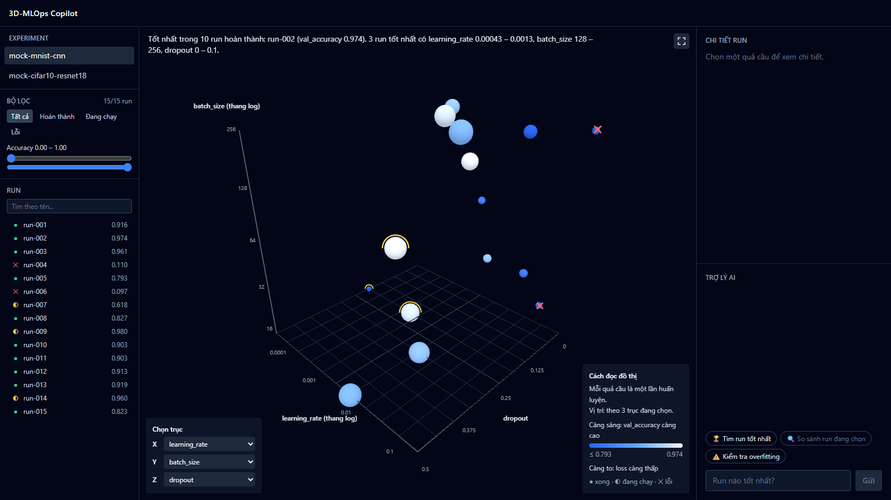
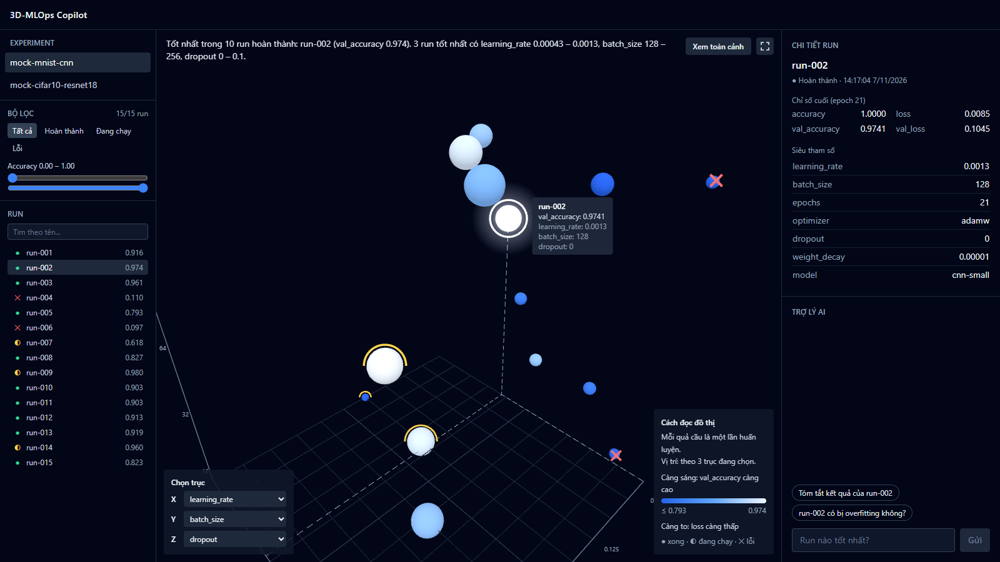
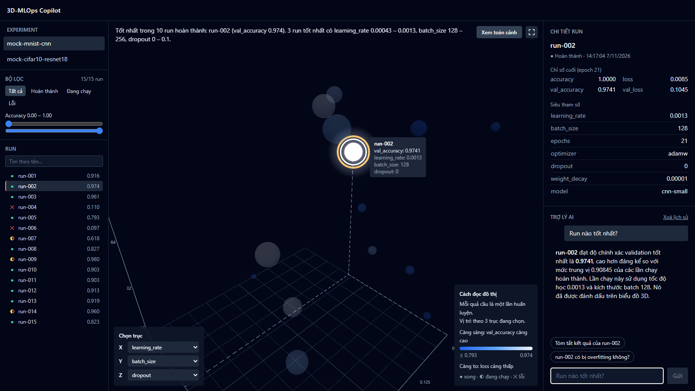

# Kịch bản demo

Demo khoảng 5 phút, đi theo một câu chuyện: *có nhiều lần huấn luyện, làm sao biết lần nào tốt, vì sao tốt, và có đáng tin không?*

## Chuẩn bị (làm trước khi demo)

Làm theo mục [Bắt đầu nhanh](../README.md#bắt-đầu-nhanh) trong README, rồi tạo dữ liệu mẫu và chạy hai server, mỗi server trong một terminal.

```bash
cd backend
uv run python -m app.utils.seed_data
```

```bash
cd backend
uv run uvicorn app.main:app
```

```bash
cd frontend
pnpm dev
```

Mở http://localhost:5173 và kiểm tra:

- `backend/.env` có `LLM_API_KEY`. Không có key thì trợ lý chỉ trả lời được câu hỏi tìm run tốt nhất, với tiền tố `[LLM giả lập]`.
- Bấm **Xoá lịch sử** trong khung chat nếu còn cuộc trò chuyện cũ.
- Chạy `uv run python scripts/smoke_test.py` trong `backend/` nếu muốn chắc mọi thứ còn hoạt động.

## Các bước

| # | Làm gì | Nói gì | Khán giả thấy gì |
| --- | --- | --- | --- |
| 1 | Mở trang, chọn `mock-mnist-cnn` | Mỗi quả cầu là một lần huấn luyện. Vị trí là cấu hình đã dùng, độ sáng và kích thước là kết quả. | Không gian 3D và câu kết luận ở đầu đồ thị |
| 2 | Kéo xoay, cuộn để zoom | Run tốt tụ lại ở một vùng learning rate, vùng trống là chỗ chưa thử. | Các quả cầu sáng nằm gần nhau |
| 3 | Bấm vào một quả cầu | Ba khung dùng chung một nguồn trạng thái. | Inspector hiện siêu tham số và chỉ số, camera bay tới, khung chat gợi ý câu hỏi |
| 4 | Đổi trục Z sang `epochs` | Trục lấy từ chính dữ liệu, siêu tham số nào dạng số cũng dùng được. | Các quả cầu di chuyển sang vị trí mới |
| 5 | Lọc trạng thái **Lỗi**, rồi bấm **Tất cả** | Xem nhanh những lần chạy hỏng. | Chỉ còn các run lỗi |
| 6 | Hỏi: *Run nào tốt nhất?* | AI không tự nghĩ ra số. Nó gọi công cụ của backend để lấy số liệu. | Chữ hiện dần, run được làm nổi bật và camera bay tới |
| 7 | Hỏi: *So sánh run-001 với run-002* | So sánh bằng số thật trong database. | Bảng so sánh và hai run được làm nổi bật |
| 8 | Hỏi: *run-002 có bị overfitting không?* | Phép chẩn đoán được tính bằng code, AI chỉ diễn giải. | Kết luận kèm khoảng cách train/val |
| 9 | Bấm **Xem toàn cảnh**, tải lại trang | Lịch sử chat được giữ lại. | Camera về vị trí đầu, lịch sử vẫn còn |

## Ảnh các bước chính

**Toàn cảnh (bước 1)**



**Bấm vào một run (bước 3)**



**Hỏi trợ lý AI (bước 6)**



Chụp lại bộ ảnh này bằng lệnh sau (dùng lượt gọi Gemini):

```bash
cd backend
uv run python scripts/smoke_test.py --real-llm --screenshots ../docs/screenshots
```

## Nếu có sự cố khi demo

| Hiện tượng | Xử lý |
| --- | --- |
| Không gian 3D báo lỗi kết nối | Backend chưa chạy. Khởi động backend rồi bấm nút thử lại trên màn hình. |
| AI báo chạm giới hạn lượt gọi | Gói miễn phí của Gemini giới hạn theo phút. Đợi khoảng một phút rồi hỏi lại. |
| Không có quả cầu nào | Database trống. Chạy lệnh tạo dữ liệu mẫu ở phần Chuẩn bị. |
