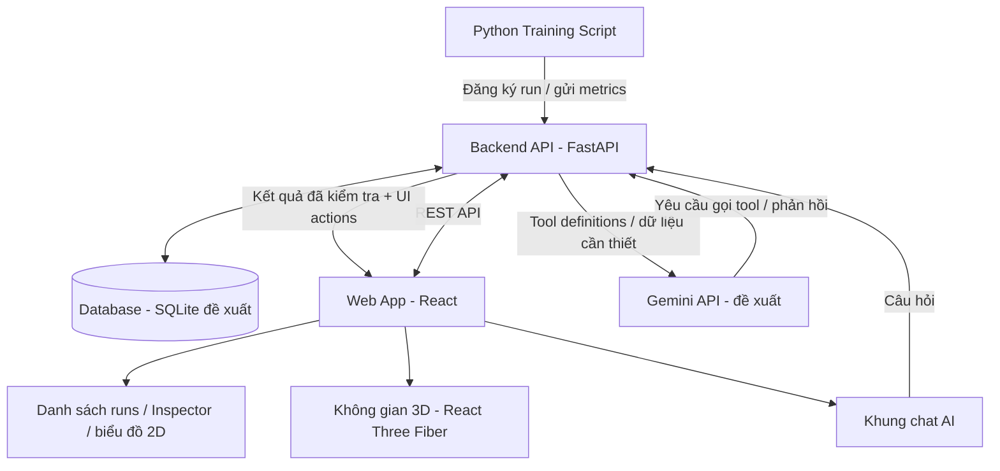

# Project Overview 3D-MLOps Copilot Platform

---

## 1. Tổng quan và mục tiêu đề tài

### 1.1. Bài toán

Khi xây dựng mô hình học máy, người thực hiện thường huấn luyện nhiều lần với các cấu hình khác nhau. Mỗi lần chạy tạo ra thông tin về **siêu tham số** (ví dụ: learning rate, batch size) và **kết quả** (ví dụ: accuracy, loss theo từng epoch).

Nếu dữ liệu nằm rải rác trong file log, bảng tính hoặc nhiều chương trình, việc tổng hợp, tìm kiếm, so sánh và xem lại quá trình huấn luyện có thể mất thời gian. Tuy nhiên, mức độ khó khăn thực tế cần được xác nhận với người dùng/doanh nghiệp; đây mới là **bài toán dự kiến**, chưa phải kết quả khảo sát.

### 1.2. Hướng giải quyết

Đề xuất xây dựng một **ứng dụng web** gồm ba phần liên kết:

1. **Quản lý và theo dõi (Track):** Tổ chức experiment, lưu runs, siêu tham số và các chỉ số huấn luyện.
2. **Trực quan hóa (Visualize):** Biểu diễn các runs trong không gian 3D để quan sát, chọn và so sánh cấu hình; đồng thời có bảng và biểu đồ 2D để xem số liệu chính xác.
3. **Trợ lý AI (Converse):** Cho phép hỏi bằng ngôn ngữ tự nhiên; truy xuất dữ liệu thật từ hệ thống, giải thích kết quả và hỗ trợ chọn/làm nổi bật runs trên giao diện 3D.

**Giá trị cần kiểm chứng:** 3D và AI có giúp người dùng tìm, hiểu hoặc so sánh kết quả thuận tiện hơn cách xem bảng/biểu đồ thông thường hay không. **Không mặc định 3D tốt hơn 2D.**

### 1.3. Người dùng và mục tiêu sử dụng

- **Người dùng dự kiến:** Sinh viên/người nghiên cứu ML, Data Scientist hoặc ML Engineer thực hiện nhiều lần huấn luyện.
- **Nhu cầu chính:** Quản lý lịch sử thí nghiệm, xem kết quả, so sánh cấu hình và hỏi đáp về dữ liệu đã ghi nhận.
- **Mức độ sản phẩm:** Đề xuất một **MVP/PoC chạy cục bộ cho một người dùng** trước khi cân nhắc mở rộng. 

---

## 2. Hệ thống cần làm những gì?

### 2.1. Các nhóm chức năng

**Mức ưu tiên:** M = cần có trong MVP; S = nên có nếu đủ thời gian; O = ngoài phạm vi MVP. Đây là **đề xuất của nhóm**, chưa phải danh sách được duyệt.

| Mã | Chức năng | Mô tả đầu ra mong đợi | Ưu tiên |
|---|---|---|---|
| F01 | Quản lý experiment | Tạo, xem danh sách và mở một experiment. | M |
| F02 | Ghi nhận run | Lưu tên, trạng thái, cấu hình, thời gian bắt đầu/kết thúc và thông tin liên quan. | M |
| F03 | Thu thập metrics | Training script gửi metrics theo epoch; hệ thống kiểm tra và lưu dữ liệu. | M |
| F04 | Danh sách, tìm kiếm và lọc | Xem runs theo experiment; lọc theo trạng thái/cấu hình/chỉ số. | M |
| F05 | Xem và so sánh kết quả | Mở thông tin run, đường biểu diễn train/validation metrics; so sánh nhiều runs. | M |
| F06 | Trực quan hóa 3D | Mỗi run hoặc nhóm run được biểu diễn bằng node có vị trí, màu và trạng thái. | M |
| F07 | Tương tác 3D | Xoay/zoom, chọn node, xem chi tiết, highlight/focus từ giao diện. | M |
| F08 | AI hỏi đáp dữ liệu | Tìm run tốt nhất, mô tả run, so sánh runs dựa trên dữ liệu backend. | M |
| F09 | AI hỗ trợ phân tích | Cảnh báo *dấu hiệu* overfitting dựa trên quy tắc rõ ràng; nêu giới hạn kết luận. | S |
| F10 | AI điều khiển giao diện | Từ câu trả lời, mở Inspector, highlight run và focus camera đúng node. | M |
| F11 | Nhập/xuất dữ liệu | Import dữ liệu mẫu hoặc xuất bảng kết quả để phục vụ demo. | S |
| F12 | Quản lý người dùng, phân quyền, model registry, tự động tối ưu HPO | Chưa triển khai ở MVP. | O |

### 2.2. Một kịch bản sử dụng hoàn chỉnh

1. Người dùng tạo experiment, ví dụ **“So sánh các cấu hình phân loại ảnh”**.
2. Người dùng chạy script huấn luyện với nhiều giá trị learning rate, batch size và dropout rate.
3. Script đăng ký run, gửi siêu tham số và bốn metrics theo từng epoch đến backend.
4. Backend kiểm tra dữ liệu, lưu vào database; frontend hiển thị danh sách runs và không gian 3D.
5. Người dùng chọn một node để xem cấu hình và learning curves trong **Inspector**.
6. Người dùng hỏi: **“Trong experiment này, run nào có validation accuracy cao nhất?”**
7. Backend tìm run phù hợp từ dữ liệu đã lưu. AI diễn đạt kết quả; giao diện làm nổi bật node tương ứng và mở thông tin run.

**Điều kiện so sánh:** Chỉ xếp hạng các runs có metric hợp lệ và cùng bối cảnh đánh giá (ví dụ cùng bộ dữ liệu, phiên bản và cách tính metric). “Tốt nhất” phải gắn với **metric, chiều tối ưu và điều kiện lọc**, không hiểu chung chung.

---

## 3. Dữ liệu đầu vào, đầu ra và phạm vi thực nghiệm

### 3.1. Dữ liệu cần có

| Nhóm dữ liệu | Trường chính | Mục đích |
|---|---|---|
| Experiment | ID, tên, mô tả, thời gian tạo | Tổ chức các runs. |
| Run | ID, experiment ID, tên, trạng thái, thời gian, seed, code version | Theo dõi từng lần chạy và hỗ trợ tái lập. |
| Cấu hình | learning_rate, batch_size, dropout_rate, các hyperparameters khác | So sánh tác động của các cấu hình. |
| Dữ liệu đánh giá | dataset_name, dataset_version/split | Tránh so sánh các kết quả không cùng điều kiện. |
| Metrics | epoch, train_accuracy, train_loss, val_accuracy, val_loss | Vẽ đường học, xếp hạng và hỗ trợ phân tích. |

### 3.2. Bộ thực nghiệm mẫu cho MVP

Đề xuất chọn **một bài toán phân loại có validation set** và một chương trình huấn luyện tạo đủ ba siêu tham số số: `learning_rate`, `batch_size`, `dropout_rate`. Dataset và mô hình cụ thể.

- **Bộ demo ban đầu:** 35 runs × 15 epochs × 4 metrics = **2.100 giá trị metric** cho toàn bộ bộ thử (không phải cho một run).
- **Quy mô mục tiêu để thử tải:** 500 runs × 50 epochs = **25.000 bản ghi metrics**, nếu lưu một bản ghi gồm bốn metric cho mỗi epoch.
- Các con số là **quy mô đề xuất từ tài liệu gốc**, không phải năng lực hệ thống đã được đo và xác nhận.

### 3.3. Mô hình dữ liệu sơ bộ

```text
experiments (1) ── (N) runs (1) ── (N) metrics

experiments: id, name, description, created_at
runs:        id, experiment_id, run_name, status, hyperparams(JSON),
             dataset_name, dataset_version, random_seed, code_version,
             started_at, finished_at
metrics:     id, run_id, epoch, train_accuracy, train_loss,
             val_accuracy, val_loss, logged_at
```

- Với schema MVP, mỗi run chỉ có **một bản ghi/epoch**: unique `(run_id, epoch)`; cần xác định cách **ghi lại cùng epoch** khi training script gửi lại request.
- Trạng thái run đề xuất: `created`, `running`, `completed`, `failed`; cần quy tắc chuyển trạng thái và xử lý run bị ngắt.
- **Giới hạn:** Schema trên phục vụ bài toán phân loại cụ thể. Nếu mở rộng sang hồi quy, clustering hoặc nhiều metric/step khác nhau, phải thiết kế metric linh hoạt hơn.

---

## 4. Hệ thống dự kiến hoạt động như thế nào?

### 4.1. Kiến trúc ở mức thành phần



- **Backend/database** là nguồn dữ liệu có thẩm quyền; frontend chỉ lưu trạng thái tương tác như node được chọn, bộ lọc và camera.
- Training script **không cần chạy trong trình duyệt**. MVP thu nhận kết quả từ script bên ngoài thay vì xây hệ thống tự khởi tạo/điều phối job training.
- Cách cập nhật run đang chạy: thử **polling** trước; chỉ dùng SSE/WebSocket nếu yêu cầu về độ trễ thực sự cần.

### 4.2. Những tình huống cần tính đến

- Script mất kết nối hoặc gửi lại metric: API phải báo lỗi rõ và có quy tắc xử lý trùng.
- Run thiếu metric/chưa hoàn thành: vẫn hiển thị trạng thái, không xếp hạng như run đầy đủ.
- Gemini lỗi, chậm hoặc hết quota: hệ thống tracking/3D vẫn sử dụng được; chatbot thông báo không khả dụng.
- Run không tồn tại: không tạo UI action trỏ đến node không hợp lệ.

### 4.3. REST API dự kiến

| Nhóm API | Công việc |
|---|---|
| `/api/experiments` | Tạo/lấy danh sách experiment và xem thông tin. |
| `/api/runs` | Tạo/lấy danh sách runs, tìm kiếm và lọc. |
| `/api/runs/{id}/metrics` | Ghi/lấy lịch sử metric theo epoch. |
| `/api/runs/{id}/status` | Cập nhật trạng thái run theo quy tắc cho phép. |
| `/api/copilot/chat` | Nhận câu hỏi; gọi backend tools; trả lời và UI actions đã kiểm tra. |

---

## 5. Trực quan hóa 3D: cần nghiên cứu và xây dựng gì?

### 5.1. Quy tắc ánh xạ dữ liệu đề xuất

| Thành phần | Cách biểu diễn |
|---|---|
| Trục X | `learning_rate`, dùng log10 khi giá trị > 0. |
| Trục Y | `batch_size`, dùng log2 khi giá trị > 0. |
| Trục Z | `dropout_rate` (0–1), dùng tuyến tính **nếu mô hình demo có tham số này**. |
| Màu node | `final_val_accuracy` theo thang màu liên tục có chú giải, ví dụ Viridis. |
| Kích thước node | Có thể thể hiện `final_val_loss`, nhưng phải chuẩn hóa và tránh gây hiểu lầm; phương án đơn giản hơn là dùng kích thước cố định. |
| Trạng thái | Phân biệt running, completed, failed; runs thiếu kết quả dùng cách hiển thị trung tính. |

**Vấn đề phải giải quyết:**

1. **Nhiều runs trùng tọa độ:** Hiển thị cụm/số lượng và cho phép mở danh sách thay vì để các node che nhau.
2. **Chỉ thấy ba siêu tham số:** Các tham số còn lại xem trong Inspector hoặc bộ lọc; không suy luận rằng 3D thể hiện đủ mọi chiều.
3. **Méo phối cảnh:** Không dùng kích thước vật thể trên màn hình làm kết luận chính xác; hiển thị số liệu ở Inspector.
4. **Tốc độ và khả năng thao tác:** Thử với 35 rồi 500 runs; đo thời gian tải, phản hồi khi click và FPS trên máy demo.
5. **Khả năng tiếp cận:** Có chú giải màu, nhãn trục, cách xem số liệu bằng bảng; tránh chỉ phân biệt bằng màu.

### 5.2. Cách chứng minh 3D có ích

Không chỉ đánh giá bằng hình thức. Chuẩn bị vài tác vụ cố định (tìm run tốt nhất, tìm runs cấu hình gần nhau, xem xu hướng loss) và thử trên:

- **Bảng/biểu đồ 2D** làm mốc so sánh.
- **Giao diện 3D không AI**.
- **Giao diện 3D có AI**.

Ghi nhận **độ chính xác và thời gian hoàn thành tác vụ**. Nếu nhóm chưa có đủ người dùng tham gia, chỉ kết luận ở mức thử nghiệm ban đầu.

---

## 6. Trợ lý AI: cần nghiên cứu và xây dựng gì?

### 6.1. Nhiệm vụ của AI

AI **không trực tiếp tính toán từ trí nhớ** khi câu hỏi yêu cầu số liệu thực nghiệm. LLM hiểu câu hỏi, chọn tool; **backend truy vấn/tính toán trên dữ liệu thật** rồi trả kết quả cho LLM diễn đạt.

| Tool backend đề xuất | Nhiệm vụ |
|---|---|
| `find_best_runs(experiment_id, metric, top_k)` | Xếp hạng runs theo metric và điều kiện hợp lệ. |
| `get_run(run_id)` | Trả cấu hình, trạng thái, metrics của run. |
| `compare_runs(run_ids)` | So sánh cấu hình và kết quả của các runs. |
| `detect_overfitting(run_id)` | Đưa ra **cảnh báo dấu hiệu**, dựa trên quy tắc phân tích learning curves đã thử nghiệm. |

**UI actions** được backend cho phép và frontend thực hiện sau khi kiểm tra: `highlight_runs`, `focus_camera`, `open_inspector`. Chúng chỉ thay đổi giao diện, **không chỉnh sửa dữ liệu huấn luyện**.

### 6.2. Giới hạn và kiểm thử

- Chỉ cho phép các tool đã khai báo; kiểm tra `experiment_id`, `run_id`, metric và giới hạn số lượt gọi.
- Định dạng câu trả lời và actions thành JSON có schema; frontend xác minh trước khi sử dụng.
- API key đặt ở backend. Hạn chế gửi dữ liệu không cần thiết hoặc thông tin nhạy cảm lên dịch vụ AI.
- Nếu thiếu dữ liệu hoặc câu hỏi vượt phạm vi, AI phải nói rõ; không tự đưa ra số liệu hoặc kết luận nguyên nhân chắc chắn.
- Kiểm thử bộ câu hỏi có đáp án chuẩn: tìm run, so sánh, tình huống metric thiếu, run không tồn tại, lỗi API và câu hỏi ngoài phạm vi.
- `detect_overfitting()` cần chốt số epoch tối thiểu, ngưỡng/xu hướng và bộ ca kiểm thử; **một quy tắc cố định không tự chứng minh kết luận đúng**.

---

## 7. Công nghệ dự kiến và lý do lựa chọn

| Thành phần | Phương án dự kiến | Vì sao phù hợp với MVP / điểm cần kiểm tra |
|---|---|---|
| Frontend | React + Vite + TypeScript | Xây dashboard dạng SPA; cần xác nhận phiên bản khi lập dự án. |
| Render 3D | Three.js qua React Three Fiber + drei | Kết hợp scene 3D với component React; thử hiệu năng và tương tác. |
| Trạng thái giao diện | Zustand (hoặc giải pháp đơn giản hơn) | Đồng bộ lựa chọn run, camera và panels; không thay thế dữ liệu backend. |
| Backend | Python + FastAPI | Phù hợp ecosystem ML, có kiểm tra request và tài liệu API. |
| Database | SQLite cho PoC cục bộ | Dễ thiết lập; cần thử ghi/đọc đồng thời, timeout, retry. |
| AI | Gemini API + SDK `google-genai` | Dùng function calling; **chọn model ID cụ thể sau khi thử chi phí, độ trễ, độ chính xác**. |
| Quản lý phụ thuộc | `uv` / `pnpm` | Dùng lockfile để môi trường nhóm nhất quán. |

**Lưu ý phiên bản:** Nếu dùng **React 18**, React Three Fiber **v8** là cặp phiên bản được tài liệu R3F hướng dẫn; nếu chuyển React 19, cần xem lại tương thích. Không tự mặc định các phiên bản của toàn bộ thư viện sẽ tương thích khi tích hợp.

### So sánh với giải pháp có sẵn

| Công cụ | Khả năng liên quan | Điều nhóm cần học/đối chiếu |
|---|---|---|
| **MLflow** | Experiment/run tracking, metrics, metadata, giao diện so sánh | Có nên dùng MLflow làm backend tracking thay vì tự xây? |
| **Weights & Biases** | Theo dõi và trực quan hóa thực nghiệm | Những tác vụ quản lý/so sánh nào đã được giải quyết tốt? |
| **TensorBoard** | Theo dõi quá trình train và các chỉ số | Cách hiển thị learning curves dễ hiểu. |
| **Optuna** | Phân tích/tối ưu hyperparameters, biểu đồ nhiều chiều | Baseline 2D và cách diễn giải mối quan hệ siêu tham số. |

---

## 8. Phạm vi MVP, tiêu chí hoàn thành và rủi ro

### 8.1. Ranh giới MVP đề xuất

**Bao gồm:** Một loại bài toán ML; một người dùng chạy cục bộ; thu thập và lưu runs/metrics; danh sách và so sánh; 3D tương tác; AI chỉ đọc dữ liệu và điều khiển hiển thị; dữ liệu demo có thể tái tạo.

**Chưa bao gồm:** Hạ tầng đa người dùng/phân quyền; model registry, lưu trữ trọng số/artifacts quy mô lớn; điều phối huấn luyện phân tán; tự động tìm hyperparameters; chứng minh tính ưu việt của 3D trên mọi tình huống.

### 8.2. Tiêu chí nghiệm thu nhóm nên đề xuất

| Hạng mục | Minh chứng khi demo/kiểm thử |
|---|---|
| Tracking | Tạo experiment, nhận runs từ script, ghi và hiển thị đủ metrics. |
| Tính toàn vẹn | Ghi lại một epoch không tạo dữ liệu mâu thuẫn; xử lý trạng thái và lỗi API rõ ràng. |
| Phân tích | Tìm đúng run tốt nhất theo metric, cùng điều kiện so sánh xác định. |
| 3D | Hiển thị được runs; chọn node mở đúng Inspector; giải quyết runs trùng vị trí. |
| AI | Câu trả lời từ dữ liệu có thể đối chiếu; highlight/focus đúng run; xử lý câu hỏi không đủ dữ liệu. |
| Quy mô | Chạy thử 35 runs và đo hiệu năng ở mục tiêu 500 runs/50 epochs; lưu kết quả đo. |
| Hướng dẫn | Có README cài đặt, dữ liệu mẫu, script demo và hướng dẫn kiểm thử. |

**Các ngưỡng hiệu năng cụ thể** (ví dụ FPS hoặc thời gian phản hồi) cần xác định sau khi biết cấu hình máy demo và yêu cầu doanh nghiệp; không coi quy mô mục tiêu là kết quả đã đạt.

### 8.3. Rủi ro chính

| Rủi ro | Cách giảm thiểu |
|---|---|
| Phạm vi chưa rõ | Xác nhận nghiệp vụ và ranh giới MVP từ đầu. |
| Không có dữ liệu phù hợp để vẽ 3D | Chốt training script, ba hyperparameters và metrics trước khi thiết kế scene. |
| 3D khó đọc hoặc nhiều node chồng lấp | Prototype sớm; có clustering, Inspector và baseline 2D. |
| AI trả lời sai hoặc không ổn định | Tool calling, schema, bộ câu hỏi kiểm thử và đối chiếu backend. |
| Ghi dữ liệu không đáng tin cậy | Validation, uniqueness, retry và kiểm thử lỗi. |
| Thời gian triển khai hạn chế | Làm luồng end-to-end tối thiểu trước, mở rộng sau. |

---

## 9. Nhóm cần thực hiện những công việc nào?

| Giai đoạn | Công việc cụ thể | Sản phẩm đầu ra |
|---|---|---|
| **P0 – Tìm hiểu & chốt yêu cầu** | Họp giảng viên/doanh nghiệp; xác định người dùng, chức năng, loại thí nghiệm, dữ liệu, phạm vi và nghiệm thu. | Tài liệu tìm hiểu đề tài, yêu cầu MVP, danh sách quyết định còn mở. |
| **P1 – Tracking & dữ liệu** | Chọn/chuẩn bị training script; thiết kế database/API; tạo experiment/run; gửi và lưu metrics; kiểm tra lỗi. | Backend chạy được với bộ dữ liệu demo thật/tái tạo. |
| **P2 – Dashboard & 3D** | Danh sách runs, bộ lọc, Inspector, learning curves; vẽ scene 3D; mapping và tương tác. | Người dùng xem và so sánh được các runs trên web. |
| **P3 – AI Copilot** | Xây backend tools; gọi LLM; xử lý JSON actions; tích hợp chat với UI; kiểm thử câu hỏi. | AI trả lời theo dữ liệu và chọn đúng run trên 3D. |
| **P4 – Tích hợp, kiểm thử & báo cáo** | Thử toàn bộ luồng, benchmark tải, so sánh 2D/3D, viết README, chuẩn bị kịch bản demo. | Sản phẩm MVP, kết quả kiểm thử, báo cáo và demo. |

**Thứ tự ưu tiên:** Hoàn thành được một luồng **training script → backend → database → dashboard/3D → AI → UI action** trước khi thêm các chức năng phụ. 

### 9.1. Kịch bản demo tối thiểu

1. Khởi động backend, frontend và cơ sở dữ liệu mẫu.
2. Tạo experiment, chạy script sinh một số runs với cấu hình khác nhau.
3. Kiểm tra runs/metrics xuất hiện ở danh sách và trong không gian 3D.
4. Chọn node, xem learning curves và so sánh hai runs.
5. Hỏi AI run có `val_accuracy` cao nhất; đối chiếu kết quả trong database/Inspector.
6. Quan sát AI highlight và focus đúng node; thử thêm tình huống run không tồn tại hoặc thiếu dữ liệu.

---

## 10. Kết luận

Đề tài không chỉ là một mô hình 3D hoặc một chatbot. **Sản phẩm cần thể hiện được một quy trình quản lý thực nghiệm học máy hoàn chỉnh**: lưu dữ liệu chạy mô hình, tổ chức và so sánh kết quả, trực quan hóa trong 3D, sau đó sử dụng AI để truy vấn và điều hướng đến thông tin liên quan.

## Tài liệu tham khảo kỹ thuật

1. [MLflow – Experiment Tracking](https://mlflow.org/docs/latest/ml/tracking/) — khái niệm experiment/run, logging và so sánh kết quả.
2. [React Three Fiber – Introduction](https://r3f.docs.pmnd.rs/getting-started/introduction) — 3D với React và tương thích phiên bản.
3. [Google Gemini API – Function Calling](https://ai.google.dev/gemini-api/docs/function-calling) — cơ chế gọi hàm từ LLM.
4. [SQLite – Write-Ahead Logging](https://www.sqlite.org/wal.html) — khả năng đọc/ghi đồng thời và giới hạn writer.
5. [Optuna – Visualization](https://optuna.readthedocs.io/en/stable/reference/visualization/index.html) — các biểu đồ phân tích siêu tham số làm mốc so sánh.
6. [scikit-learn – Validation Curves & Learning Curves](https://scikit-learn.org/stable/modules/learning_curve.html) — cách hiểu training/validation scores và overfitting.