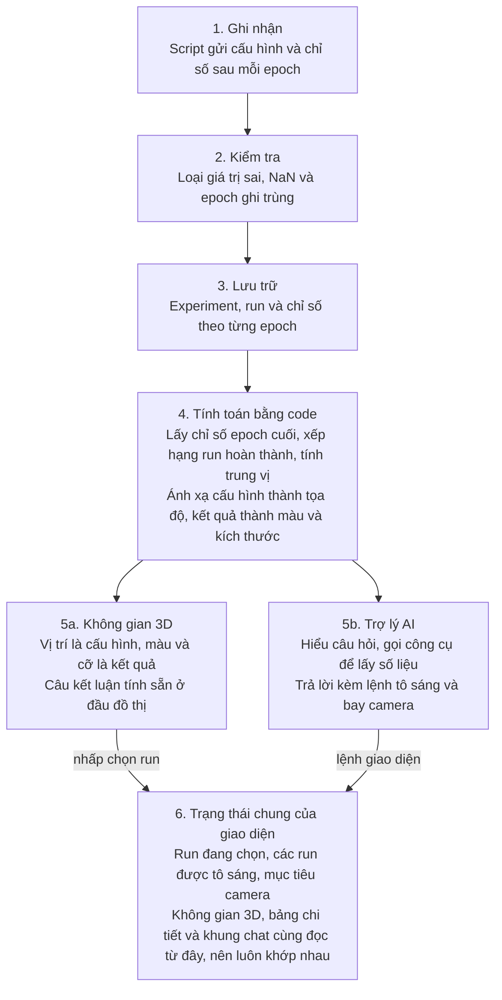
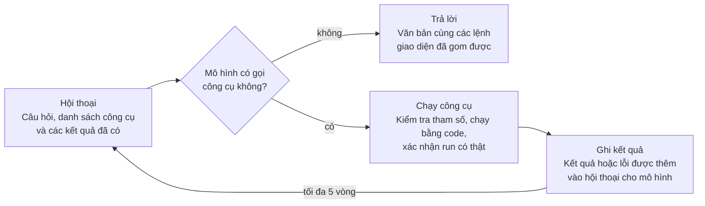

# 3D-MLOps Copilot — Tài liệu tổng quan dự án

Cập nhật: 2026-11-08

## 1. Tóm tắt

3D-MLOps Copilot giúp người huấn luyện mô hình trả lời nhanh ba câu hỏi: run nào tốt nhất, vì sao nó tốt, và nên thử cấu hình nào tiếp theo.

Dự án kết hợp ba việc thành một sản phẩm:

- **Theo dõi:** ghi lại cấu hình và kết quả theo từng epoch của mọi lần huấn luyện (run).
- **Nhìn thấy:** đặt mỗi run thành một điểm trong không gian 3D. Vị trí là cấu hình, màu và kích thước là kết quả.
- **Hỏi đáp:** trợ lý AI trả lời bằng ngôn ngữ tự nhiên, dựa trên số liệu thật, và chỉ thẳng vào các run liên quan trên đồ thị.

Đây là bản Proof of Concept cho một người dùng, chạy trên máy cá nhân.

## 2. Bối cảnh và bài toán

Bài toán cốt lõi là biến hàng nghìn con số rời rạc của nhiều lần huấn luyện thành quyết định: giữ cấu hình nào và thử gì tiếp.

Huấn luyện mô hình là quá trình thử sai. Người làm chạy nhiều run với các siêu tham số khác nhau, rồi so sánh kết quả. Với bộ thử chuẩn của dự án (35 run, 15 epoch, 4 chỉ số), một lần thử đã sinh tới 2.100 con số.

| Khó khăn | Câu hỏi người dùng cần trả lời | Vì sao bảng số liệu không đủ |
| --- | --- | --- |
| Không thấy quan hệ cấu hình và kết quả | Run tốt nằm ở vùng cấu hình nào? | Bảng chỉ so sánh được từng cột, không cho thấy nhiều siêu tham số cùng lúc |
| Không thấy khoảng trống | Vùng nào chưa được thử? | Bảng chỉ liệt kê cái đã có, không thể hiện cái còn thiếu |
| Run lỗi làm nhiễu so sánh | Các run bình thường khác nhau bao nhiêu? | Một run phân kỳ kéo giãn toàn bộ thang giá trị |
| Chẩn đoán tốn công | Run này có bị overfit không? | Phải đọc đường cong train và validation của từng run |
| Trợ lý AI dễ bịa số | Có thể tin câu trả lời của AI không? | Nếu để AI tự đọc và tính, con số trả về khó kiểm chứng |

**Phát biểu bài toán.** Đầu vào là một tập run. Mỗi run gồm bộ siêu tham số, trạng thái, và chuỗi chỉ số theo epoch (accuracy, loss, val_accuracy, val_loss). Đầu ra gồm ba phần:

1. Xếp hạng các run theo một chỉ số, chỉ tính run đã hoàn thành.
2. Một biểu diễn trực quan cho thấy cấu hình và kết quả của mọi run cùng lúc.
3. Câu trả lời bằng ngôn ngữ tự nhiên, mọi con số đều truy ngược được về dữ liệu gốc.

## 3. Mục tiêu và phạm vi

Mục tiêu của bản PoC là chứng minh luồng đầy đủ trong dưới một phút demo: huấn luyện, ghi nhận, trực quan hóa, rồi hỏi AI.

| Mục tiêu | Tiêu chí thành công |
| --- | --- |
| Theo dõi các lần huấn luyện | Ghi được cấu hình và chỉ số theo epoch, có ít nhất 5 run mẫu |
| Trực quan hóa kết quả trong 3D | Hiển thị ít nhất 50 run ở 60 khung hình/giây; nhấp vào run thì thấy chi tiết |
| Hỏi đáp với trợ lý AI | Trả lời được 3 loại câu hỏi: run tốt nhất, so sánh, chẩn đoán; dưới 5 giây |
| Đồng bộ giao diện | AI trả lời xong thì đồ thị tự tô sáng và bay tới run liên quan |

**Ngoài phạm vi PoC:** đăng nhập và nhiều người dùng, lưu trữ file mô hình, đưa mô hình lên vận hành. Quy mô thiết kế là tối đa khoảng 500 run, mỗi run 50 epoch, cho bài toán phân loại.

## 4. Người dùng và kịch bản sử dụng

Người dùng chính là người trực tiếp huấn luyện mô hình và phải quyết định cấu hình tiếp theo sau mỗi đợt thử.

| Kịch bản | Người dùng làm gì | Hệ thống phản hồi |
| --- | --- | --- |
| Ghi nhận một đợt thử | Chạy huấn luyện như bình thường, thêm vài dòng ghi log | Lưu cấu hình và chỉ số mỗi epoch. Tự đánh dấu run hoàn thành, hoặc lỗi nếu gặp ngoại lệ hay loss không hữu hạn |
| Khám phá kết quả | Mở không gian 3D, xoay và phóng to | Hiện mỗi run là một quả cầu. Đầu đồ thị có sẵn một câu kết luận tính từ dữ liệu |
| Xem một run | Nhấp vào quả cầu | Camera bay tới, có đường gióng xuống trục, bảng bên hiện cấu hình và chỉ số cuối |
| Hỏi run tốt nhất | Hỏi “Run nào có accuracy cao nhất?” | AI nêu giá trị so với trung vị, tô sáng run đó, làm mờ các run còn lại và bay camera tới |

## 5. Cách giải quyết

Dự án giải bài toán bằng cách tách rõ ba vai trò: code tính số liệu, không gian 3D cho thấy hình dạng dữ liệu, AI diễn giải bằng lời.



Dữ liệu chỉ đi một chiều từ lúc huấn luyện đến nơi lưu trữ. Sau đó đồ thị và AI cùng đọc từ một kho, nên dùng chung một bản số liệu gốc.

Ba quyết định thiết kế tạo nên cách giải này:

- **Vị trí là đầu vào, hình thức là đầu ra.** Vị trí quả cầu cho biết run được cấu hình thế nào. Màu và kích thước cho biết kết quả. Nhờ vậy cụm sáng là vùng cấu hình tốt, khoảng trống là vùng chưa thử.
- **AI không tự tính số.** AI chỉ chọn công cụ cần gọi. Con số do code tính từ dữ liệu thật, nên kiểm chứng được và vẫn chạy tốt khi có hàng trăm run.
- **AI điều khiển giao diện bằng lệnh có cấu trúc.** Lệnh sinh ra từ công cụ, không tách từ văn bản AI viết. Mã run phải có thật trong dữ liệu thì lệnh mới được gửi đi.

## 6. Các thuật toán sử dụng

Dự án không tạo thuật toán học máy mới. Giá trị nằm ở chuỗi thuật toán nhỏ biến dữ liệu thô thành xếp hạng, hình ảnh và câu trả lời kiểm chứng được.

Mục 6.1 đến 6.8 đã có trong code. Mục 6.9 là phần dự kiến.

| Nhóm | Thuật toán | Giải quyết việc gì |
| --- | --- | --- |
| Tạo dữ liệu | Tìm kiếm ngẫu nhiên (6.1) | Chọn cấu hình để thử |
| Tạo dữ liệu | Mạng nơ-ron nhiều lớp (6.2) | Sinh kết quả huấn luyện thật |
| Tạo dữ liệu | Mô phỏng đường cong học (6.3) | Sinh dữ liệu giả để phát triển nhanh |
| Phân tích | Xếp hạng và trung vị (6.4) | Tìm run tốt nhất và đặt nó vào bối cảnh |
| Trực quan | Chuẩn hóa theo thang log (6.5) | Đặt cấu hình vào không gian 3D |
| Trực quan | Rào Tukey và nội suy màu (6.6) | Giữ độ tương phản khi có run phân kỳ |
| Trợ lý AI | Vòng lặp gọi công cụ (6.7) | Trả lời bằng số liệu thật |
| Tương tác | Làm mượt hàm mũ (6.8) | Bay camera đều ở mọi tốc độ khung hình |

### 6.1 Tìm kiếm ngẫu nhiên

Bộ thử chuẩn gồm 30 cấu hình ngẫu nhiên và 5 cấu hình cố ý xấu. Cùng một hạt giống sẽ sinh ra cùng bộ cấu hình, nên cả nhóm tái tạo được dữ liệu.

| Siêu tham số | Cách lấy mẫu | Miền giá trị |
| --- | --- | --- |
| learning_rate | Đều trên thang log | 10^-4 đến 10^-1 |
| batch_size | Chọn đều | 16, 32, 64, 128, 256 |
| hidden_layers | Chọn đều | (64), (128), (256), (128, 64), (256, 128) |
| optimizer | Adam 2/3, SGD 1/3 | adam, sgd |
| alpha (điều chuẩn L2) | Chọn đều | 0, 1, 2, 5, 10 |
| epochs | Cố định | 15, để các run so sánh được với nhau |

Với cùng số run, cách này thử được nhiều giá trị learning_rate khác nhau hơn lưới cố định. Lấy mẫu trên thang log vì learning_rate ảnh hưởng theo bậc độ lớn.

5 cấu hình xấu tạo ra các ca có sẵn đáp án. 3 cấu hình gây overfit (mạng lớn, không điều chuẩn, chỉ 200 mẫu). 2 cấu hình gây mất ổn định (SGD với learning_rate 0,5 và 1,0).

### 6.2 Mạng nơ-ron nhiều lớp cho dữ liệu thật

Dữ liệu thật đến từ bài toán phân loại chữ số viết tay bằng mạng nơ-ron nhiều lớp (MLP). Mô hình này chỉ là nguồn dữ liệu demo, không phải sản phẩm chính.

- **Chia dữ liệu:** 80% huấn luyện, 20% kiểm định, giữ nguyên tỉ lệ từng lớp. Bộ MNIST mặc định dùng 10.000 ảnh.
- **Huấn luyện:** mỗi epoch là một lượt qua tập huấn luyện, tối ưu bằng Adam hoặc SGD có momentum 0,9.
- **Đánh giá mỗi epoch:** accuracy và log loss trên cả hai tập.
- **Phát hiện run hỏng:** nếu chỉ số không hữu hạn (NaN hoặc vô cực), run dừng lại và chuyển sang trạng thái lỗi.

### 6.3 Mô phỏng đường cong học

Thuật toán này sinh dữ liệu giả trông như thật mà không cần huấn luyện. Nhờ đó giao diện và kiểm thử có sẵn đủ loại run: tốt, overfit, phân kỳ, đang chạy.

Trần accuracy của một cấu hình giảm khi nó xa điểm tối ưu. Trong đó d là khoảng cách theo log10 tới learning_rate tốt nhất, b là batch_size:

```math
\text{ceiling} = a_{\text{chance}} + (a_{\text{peak}} - a_{\text{chance}})\left(1 - \min(0.6,\ 0.06\,d^2) - 0.01\,\lvert\log_2(b/64)\rvert - p_{\text{opt}}\right)
```

Đường học tiến tới trần theo hàm mũ. Learning_rate càng nhỏ thì hằng số thời gian τ càng lớn, tức hội tụ càng chậm:

```math
\text{acc}(t) = a_{\text{chance}} + (\text{ceiling} - a_{\text{chance}})\left(1 - e^{-t/\tau}\right)
```

Sau một epoch nhất định, các run ít điều chuẩn có accuracy train tăng thêm và accuracy validation giảm dần. Run phân kỳ có loss nhân theo cấp số 3 ở hai epoch cuối. Mọi đường đều được thêm nhiễu.

### 6.4 Xếp hạng run và trung vị

Thuật toán trả về các run tốt nhất theo chỉ số được hỏi, kèm trung vị của toàn bộ run hoàn thành.

1. Chỉ giữ run đã hoàn thành và có chỉ số. Run lỗi hoặc đang chạy chưa có kết quả cuối nên bị loại.
2. Lấy giá trị của chỉ số ở epoch lớn nhất. Bỏ run không có giá trị đó.
3. Sắp xếp giảm dần. Riêng loss và val_loss sắp xếp tăng dần.
4. Trả về k run đầu (k từ 1 đến 10) và trung vị của mọi giá trị.

Dùng trung vị thay vì trung bình vì một run rất kém có thể kéo trung bình xuống, còn trung vị ít bị ảnh hưởng. Câu kết luận ở đầu đồ thị cũng dùng cách xếp hạng này, rồi nêu khoảng giá trị siêu tham số của 3 run đứng đầu.

### 6.5 Chuẩn hóa cấu hình thành tọa độ 3D

Mỗi trục được biến đổi theo thang phù hợp rồi chuẩn hóa min-max về đoạn từ 0 đến 10. Trong đó s là phép biến đổi thang của trục:

```math
p(v) = \frac{s(v) - s_{\min}}{s_{\max} - s_{\min}} \times 10
```

| Trục | Siêu tham số | Thang s | Lý do |
| --- | --- | --- | --- |
| X | learning_rate | log10 | Giá trị trải qua nhiều bậc độ lớn |
| Y | batch_size | log2 | Giá trị thường là lũy thừa của 2 |
| Z | Khóa số đầu tiên có ít nhất 2 giá trị khác nhau | Tuyến tính | Ưu tiên dropout, rồi epochs, rồi các khóa khác theo bảng chữ cái |

Thang log là bắt buộc với learning_rate. Trên thang tuyến tính từ 0,0001 đến 0,1, hai giá trị 0,0001 và 0,001 chỉ cách nhau 0,9% chiều dài trục. Trên thang log, chúng cách nhau một phần ba trục.

Các trường hợp biên được xử lý rõ ràng:

- Trục chỉ có một giá trị thì mọi run nằm giữa trục.
- Không có khóa nào cho trục Z thì không gian phẳng theo Z.
- Run thiếu khóa, hoặc có giá trị không dương trên trục log, nằm ở mặt phẳng “không xác định” và được vẽ mờ.

Accuracy và loss không được dùng làm ba trục cùng epoch. Hai chỉ số này gần như tỉ lệ nghịch nên các điểm sẽ dồn trên một đường.

### 6.6 Rào Tukey và nội suy màu

Thuật toán này giữ độ tương phản: một run phân kỳ không được khiến các run còn lại có cùng một màu.

1. Lấy giá trị của các run hoàn thành. Nếu chưa có run hoàn thành nào có chỉ số thì dùng mọi run.
2. Khi có từ 4 giá trị, tính Q1, Q3 và IQR = Q3 − Q1, rồi bỏ ngoại lệ ở phía xấu.
3. Chuẩn hóa mỗi giá trị về t trong đoạn từ 0 đến 1, kẹp ở hai đầu.
4. Nội suy màu tuyến tính qua ba mốc: xanh đậm, xanh nhạt, gần trắng.

```math
\text{accuracy} \ge Q_1 - 1.5\,\text{IQR} \qquad\qquad \text{loss} \le Q_3 + 1.5\,\text{IQR}
```

Chỉ phía xấu bị cắt, nên run tốt nhất luôn nhận màu sáng nhất. Run bị cắt vẫn hiển thị ở màu thấp nhất, và chú giải ghi nhận điều đó. Màu dùng val_accuracy, thiếu thì dùng accuracy.

Bán kính dùng cùng cách chuẩn hóa trên val_loss, thiếu thì dùng loss. Loss cao thì quả cầu nhỏ:

```math
r = 0.5 - 0.35\,t_{\text{loss}}
```

### 6.7 Vòng lặp gọi công cụ của trợ lý AI

Trợ lý dùng kỹ thuật gọi công cụ (tool calling): mô hình ngôn ngữ chỉ chọn công cụ và diễn giải kết quả. Mô hình không nhận toàn bộ dữ liệu trong prompt.



- **Công cụ sai không làm hỏng vòng lặp.** Tên sai, tham số sai hoặc run không tồn tại đều thành thông báo lỗi để mô hình tự sửa.
- **Hai nhóm công cụ.** Công cụ truy vấn đọc dữ liệu. Công cụ giao diện chỉ ghi lại lệnh tô sáng, bay camera, mở chi tiết.
- **Mô hình im lặng thì được nhắc một lần.** Nếu sau lần gọi cuối mô hình không viết gì, hệ thống yêu cầu nó trả lời.
- **Ràng buộc trong chỉ dẫn.** Mọi con số phải lấy từ công cụ. Mô hình không được khẳng định một siêu tham số gây ra kết quả.

### 6.8 Làm mượt hàm mũ khi bay camera

Mỗi khung hình, camera tiến một phần khoảng cách còn lại tới đích, với Δt là thời gian giữa hai khung:

```math
x \leftarrow x + \left(1 - e^{-3.5\,\Delta t}\right)(x_{\text{target}} - x)
```

Nhờ Δt nằm trong công thức, chuyển động có cùng tốc độ trên máy mạnh và máy yếu. Điểm nhìn nằm giữa tâm không gian và run đích, nên trục vẫn nằm trong khung hình. Người dùng kéo chuột thì phép bay dừng ngay.

### 6.9 Các thuật toán dự kiến

Các thuật toán dưới đây có trong kế hoạch nhưng chưa có trong code.

| Thuật toán | Ý tưởng | Kết quả |
| --- | --- | --- |
| Phát hiện overfitting | Theo dõi khoảng cách train và validation qua các epoch, tính bằng code | Kết luận kèm số liệu chứng minh |
| So sánh run | Đối chiếu siêu tham số và chỉ số cuối | Danh sách điểm khác nhau |
| Tóm tắt experiment | Thống kê run tốt nhất, kém nhất, trung bình, phân bố | Bức tranh tổng quan |
| Gợi ý cấu hình tiếp theo | Dựa trên đặc điểm của các run tốt trước đó | Khoảng giá trị nên thử |
| Giảm chiều PCA | Chiếu nhiều hơn 3 siêu tham số xuống 3 chiều | Một chế độ xem 3D khác |

Với phát hiện overfitting, em đề xuất quy tắc sau. Gọi g(t) là accuracy trừ val_accuracy tại epoch t, T là epoch cuối. Run bị gắn cờ overfit khi cả hai điều kiện đúng:

```math
g(T) > 0.05 \quad\text{và}\quad \text{val\_loss}(T) > 1.1 \times \min_{t}\ \text{val\_loss}(t)
```

Hai ngưỡng này là giả định ban đầu. Em sẽ hiệu chỉnh chúng trên 3 run cố ý overfit của bộ thử chuẩn.

## 7. Hiện trạng và hạn chế

Luồng “theo dõi, nhìn thấy, hỏi run tốt nhất” đã có trong code. Phần còn thiếu lớn nhất là khả năng so sánh và chẩn đoán của trợ lý AI.

| Phần | Đã có | Còn thiếu |
| --- | --- | --- |
| Theo dõi | Ghi experiment, run, chỉ số theo epoch; kiểm tra dữ liệu; hai nguồn dữ liệu thật và giả | Xoá experiment và run |
| Không gian 3D | Trục mặc định, màu, kích thước, trạng thái, nhấp chọn, bay camera, câu kết luận | Tự chọn trục; biểu đồ chỉ số theo epoch trong bảng chi tiết; tự cập nhật run đang chạy |
| Trợ lý AI | Vòng lặp gọi công cụ, tìm run tốt nhất, ba lệnh điều khiển giao diện | Công cụ xem chi tiết run, so sánh, phát hiện overfitting; bộ câu hỏi đo độ chính xác |

Các hạn chế em đã nhận ra khi đọc lại thuật toán:

| Hạn chế | Ảnh hưởng | Hướng xử lý |
| --- | --- | --- |
| Xếp hạng theo epoch cuối, không phải epoch tốt nhất | Run bị overfit về cuối có thể bị đánh giá thấp hơn khả năng thật | Thêm lựa chọn xếp hạng theo epoch tốt nhất |
| Chọn run tốt nhất bằng tập validation, chưa có tập test | Accuracy của run thắng có xu hướng cao hơn thực tế | Giữ riêng một tập test trong dữ liệu demo |
| Mọi run trong bộ thử dùng cùng một hạt giống | Chưa biết chênh lệch nhỏ là do cấu hình hay do ngẫu nhiên | Chạy lại các run đứng đầu với nhiều hạt giống |
| 3 trục chỉ hiện được 3 siêu tham số dạng số | optimizer và hidden_layers không thể hiện trên vị trí | Cho chọn trục, cân nhắc giảm chiều |
| Đặt trục dựa vào tên khóa | Run dùng lr thay vì learning_rate bị đưa ra mặt phẳng “không xác định” | Chuẩn hóa tên khóa khi ghi nhận |
| Chỉ có 4 chỉ số cố định | Chỉ phù hợp bài toán phân loại, chưa có F1, MSE, R² | Cho phép chỉ số tùy biến |
| Trợ lý dùng dịch vụ mô hình bên ngoài, gói miễn phí | Bị giới hạn lượt gọi; nội dung gửi đi có thể được dùng để cải thiện sản phẩm | Không đưa dữ liệu nhạy cảm vào tên run hay câu hỏi |

Hướng phát triển theo thứ tự ưu tiên: hoàn thiện công cụ chẩn đoán và so sánh, thêm chọn trục và biểu đồ theo epoch, rồi kiểm thử độ chính xác của câu trả lời AI.

## 8. Câu hỏi xin ý kiến mentor

Em cần mentor góp ý năm điểm sau trước khi làm tiếp phần chẩn đoán.

1. Quy tắc và ngưỡng phát hiện overfitting ở mục 6.9 đã hợp lý chưa?
2. Nên xem “run tốt nhất” theo epoch cuối hay epoch tốt nhất?
3. Kế hoạch đang ghi hai mức thời gian AI trả lời: dưới 5 giây và dưới 8 giây. Nên chốt mức nào?
4. Dự án có cần phần so sánh với các công cụ theo dõi thực nghiệm đang có trên thị trường không?
5. Có nên mở rộng sang bài toán ngoài phân loại ngay trong giai đoạn này không?

### Thuật ngữ

| Thuật ngữ | Ý nghĩa |
| --- | --- |
| Experiment | Một nhóm run cùng mục tiêu |
| Run | Một lần huấn luyện với một cấu hình cụ thể |
| Siêu tham số | Cấu hình chọn trước khi huấn luyện, ví dụ learning_rate |
| Overfitting | Mô hình tốt trên tập huấn luyện nhưng kém trên dữ liệu chưa thấy |
| Phân kỳ | Loss tăng vọt thay vì giảm dần, thường do learning_rate quá lớn |
| Gọi công cụ | Mô hình ngôn ngữ yêu cầu hệ thống chạy một hàm rồi dùng kết quả |
